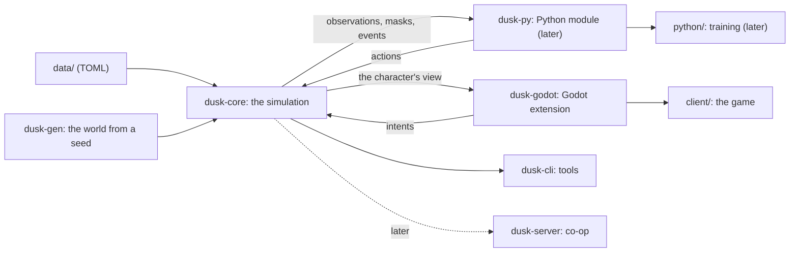

# Duskhold — engine and architecture

*Draft 3, 2026-11-09: reviewed against the code after build step 5 (see "The 2026-11-09 review", before the build order). `CONCEPT.md` says what the game is; this says how it's built.*

## Decided (2026-11-05)

- **The game comes first.** The bot comes later, to train on the game once there is one, and maybe to drive its NPCs (the user: "the bot is not a primary in this at all. I'm more interested in developing the game"). Four things the bot will need also help the game, so they stay:
  - a deterministic core: any bug or death can be replayed;
  - one rule for timed actions;
  - the game knowing what's possible: the player's greyed-out buttons;
  - the character perceiving only what it should.
- **The stack:** a Rust core and a Godot 4 client, with Python for the bot later.
- **The look:** 3D models under an orthographic camera.
- **The grain:** 10 ticks a second, chunks of 32 × 32 tiles.
- **The setup:** the Rust toolchain and maturin. Where that stands is under "Setup on this PC".

**Default** marks Claude's choices, open to change. **Open** marks questions for the user, listed at the end.

## In one screen

| | Choice |
|---|---|
| Engine | Our own simulation core, `dusk-core`, in **Rust**: all of the game's rules, with no graphics and no I/O |
| The game | A **Godot 4** client that runs the core in-process (a GDExtension, through gdext), draws what the character perceives and sends what the player wants as intents |
| The bot (later) | A **Python** module, `duskhold` (PyO3, built with maturin), that steps many worlds at once on Rust threads into NumPy arrays for training, with `ppo.py` from `11_PPO-Zombie`. Trained policies can then drive NPCs inside the core, with no Python in the game |
| World | Tiles with walls on their edges (Zomboid's way), floors from cellars to attics, chunks of 32 × 32 tiles; full detail near the character, a population layer everywhere else |
| Time | A fixed tick, 10 a second of action time at 1×; a world clock 24× faster (a day is an hour at 1×, Zomboid's default) |
| Determinism | The same build, seed and intents give the same game, tick for tick; a replay is a seed and the intents |
| Content | TOML data files; buildings as text grids; the world generated from a seed out of hand-made pieces |
| Saves | The seed, plus only what changed |
| Look | 3D low-poly models under a fixed orthographic camera at Zomboid's angle |
| Later | Lua (`mlua`) for quests, events and mods; a headless server for co-op |



## Why our own core

The concept asks for things a game engine's simulation layer doesn't give:

- an open world in chunks, with a population layer for what's off-screen, and hundreds of creatures sensing and moving at once;
- time skips: sleeping through a night or waiting out the rain runs the world at hundreds of times real speed (Zomboid fast-forwards a sleep the same way);
- deterministic replays: any bug or death can be played back exactly;
- later, the same rules called from Python for the bot, at 1,000× real time or more per core.

So the core is a library with no graphics, and everything else (the game, the tools, the tests, later the bot) calls it. The cost is writing our own world, systems and tools; Godot is only the client.

## Why Rust

Measured on this PC (2026-11-05, Python 3.14.2, 24 logical CPUs; `research/python_tick_bench.py` and `research/python_hotspots_bench.py`):

| Pure Python | Speed |
|---|---|
| A stripped-down tick: 100 dead hear and see the player and step toward it | 18,900 ticks/s (1,890× real time) |
| The same with 500 dead | 4,900 ticks/s (490×) |
| The character's field of view, radius 20 (recursive shadowcasting) | 0.68 ms each |
| A*, 30–50 tiles | 1.57 ms each |

- **The stripped tick leaves out most of the work:** fields (light, scent, heat), bodies and needs, items, AI states, pathfinding, the bot's field of view at each decision. Ten goblins re-planning once a second is one A* per tick: 1.6 ms, which alone caps Python at about 600 ticks/s. A full tick in Python would land around 400–1,700 ticks/s, 40–170× real time per core (estimate). The game at 1× needs only 10 ticks a second. But a night's sleep fast-forwards eight game hours, 12,000 ticks across the whole active area, and Zomboid does that in a few seconds; the bot later wants 1,000× or more.
- **Rust, measured on identical work (2026-11-06):** `crates/dusk-cli/examples/python_twin.rs` ports the Python script line for line. It ran at 3,600,000 ticks/s with 100 dead (195× the Python script's 18,466 that day) and 700,000 with 500 (151× its 4,651). The real core's numbers are under the performance budget below.
- **PyO3 and maturin** make the core an ordinary Python module. NumPy arrays are filled in place (no copies), and the GIL is released while 16–24 worlds step on Rust threads.
- **gdext** puts the same core inside the Godot game, in-process.
- **WebAssembly** puts it in a browser: replays in the dashboard, maybe a browser build one day.
- **Determinism** comes easily: no garbage collector, integer tiles, and full control of iteration order and randomness.

Considered:

| Option | Why not, at least for the core |
|---|---|
| Python | The quickest to change, and the RL stack's own language. But the numbers above put it at 40–170× real time per core, and every region adds work. It stays for everything around the core |
| C# (Godot's own language) | First-class in Godot, but the Python bridge is clumsy (pythonnet, or a C ABI through NativeAOT) |
| C++ | As fast, but less safe, and its Python and Godot bindings are no better |
| Python + Numba | One language, but entities, inventories and AI fit Numba badly, and Numba trails each Python release by months |
| TypeScript (MeowMix's stack) | Runs natively in a browser, but the bot would have to talk to it over a socket |

The costs of Rust:

- Claude writes it; the user mostly judges behaviour (the dashboard, replays) rather than reading code.
- A toolchain to install.
- Compile times (seconds, incremental).
- The borrow checker pushes the design toward ids and arenas, which suits a simulation anyway.

## Why Godot for the game

- **Practical:** free (MIT) and light, with a real UI system for Zomboid's windows (inventory lists, the health panel, right-click menus), an editor, and exports to Windows, Linux and macOS.
- **In-process:** the core runs inside the game's process through gdext.
- **3D under an orthographic camera** (Default). Zomboid itself draws 3D characters over 2D tiles.
  - Characters are rigged low-poly models: gear shows on the body, they can face any way, and animations are shared across models.
  - Torchlight and day and night are real lighting.
  - Walls are cut away in a shader.
  - Free CC0 kits (Kenney, KayKit, Quaternius) cover the first playable.
  - The alternative, 2D sprites, multiplies the art: 8 directions × every animation × every piece of gear.
- **The client never decides anything.** It draws the view the core gives it and turns input into intents. What's visible is always the core's answer, even where the rendered lighting looks a little different from the gameplay light.

Considered: Bevy (Rust throughout, but pre-1.0 churn and a thin UI and editor), a browser client (PixiJS and the core in WebAssembly: playable on a phone, but the UI and lighting built by hand), and Unity (heavier, with licensing).

## The core: `dusk-core`

### The API, in short

```rust
impl World {
    pub fn new(defs: Arc<Defs>, settings: &Sandbox, seed: u64) -> World;           // a new realm
    pub fn from_scenario(defs: Arc<Defs>, scenario: &Scenario, seed: u64) -> World; // a slice for the bot
    pub fn intent(&mut self, actor: ActorId, intent: Intent); // the player, a bot, an NPC: the same call
    pub fn step(&mut self, ticks: u32);
    pub fn view(&self, actor: ActorId, out: &mut View);       // what this actor perceives (the client)
    pub fn observe(&self, actor: ActorId, out: &mut [f32]);   // the same, as named numbers (the bot)
    pub fn mask(&self, actor: ActorId, out: &mut [bool]);     // what it can do right now
    pub fn events(&mut self) -> Drain<'_, Event>;             // hits, XP, deaths, sounds, messages
    pub fn state_hash(&self) -> u64;
    pub fn save(&self, dir: &Path) -> io::Result<()>;
}
```

An `Intent` is anything a controller can ask for:

- idle;
- move (a heading, walking or running), or walk to a tile (pathfinding);
- attack, shove;
- interact (a door, a container, a window);
- use an item (eat, drink, equip, drop, bandage, ...);
- cast, build;
- toggle sneak, run or light;
- cancel.

A player's click names exactly which item; a bot's "pick up food" names the nearest food worth taking, as in ZomboidRL. Both become the same actions.

### World model

- **Tiles:** each tile (x, y, z) has terrain (grass, mud, road, water, ...), a floor, a roof (so sunlight and rain know what's indoors), a light level and a few flags.
- **Edges** (Zomboid's walls): each tile owns its north and west edge. An edge holds nothing, a wall, a door, a window or a fence, with a material and a state (open, locked, barricade level, health). Whether you can step from one tile to the next depends on the edge between them, and a diagonal step needs both of its sides open: no corner cutting, the lesson of ZomboidRL's `paths`.
- **Fixtures** sit on tiles: furniture, containers, fires, wards, traps, webs.
- **Floors:** z runs from −2 (cellars) to +3 (attics), linked by stairs and ladders. Dungeons, later, are separate maps entered through an entrance.
- **Chunks** are 32 × 32 tiles on every floor. A chunk holds its tiles, edges, fixtures and ground items, plus a flag for whether anything changed.
- **Actors** (the character, NPCs, creatures) are plain structs in a generational arena (our own, `arena.rs`: the core has no dependencies), not a general ECS (Default). There are few kinds of entity and we know them all, and plain structs are easier to read, save and keep deterministic.
- **Items are values** (definition, quality, condition, affixes, identified or not, contents) inside an inventory, a container or a tile's ground list. A town holds thousands of them, so they're kept cheap. Only the few that need it carry an id: uniques, attuned items, a revenant's gear.
- **Containers fill from the seed.** What's in a cupboard is a function of the seed and the cupboard's position, so an unopened container stores nothing. It's filled the first time someone looks, and saved from then on.
- **Definitions** (creatures, items, spells, rooms: everything from the data files) are loaded once, read-only, and shared by every world on every thread.

### Time

- **Action time:** a tick is 0.1 s at 1×. Movement, swings and timed actions count ticks.
- **The world clock** runs 24× faster by default: a game day is an hour at 1×, Zomboid's default day length and a sandbox setting. So a tick is 2.4 s of clock time. Day and night, needs, healing, crops, weather and the Long Dusk run on the clock, while a swing still takes a real second. Zomboid works the same way.
- **Speeds:** pause, 1×, 2×, 5× and "faster while safe" for players; uncapped for bots.
- **Not every system runs every tick:**

  | Every | Runs |
  |---|---|
  | tick | actions, movement, combat, endurance and bleeding |
  | 5 ticks | perception and AI for most creatures, the sound and scent fields, the bot's decision (Default) |
  | 25 ticks (a game minute) | needs, sleep, healing; moodles are worked out when asked |
  | 100 ticks | fire, weather, the population layer |
  | clock hour or day | holdout stores, loot respawn, the Long Dusk |

  Each system's turn is staggered by actor id, so a hundred creatures don't all think on the same tick.

### The tick, in a fixed order

The list below is the plan for the whole game. What the core runs today (`World::tick_once`) is its first half: each actor's timed action or else its step, then hearing, then thinking (whose intents act on the next tick), then grips, bodies, needs, lights and drag-downs. A sound made before the hearing pass is heard that tick; one made after it (a groan, as a creature thinks) on the next.

1. **Intents** from controllers (the player's input, bots, NPC and creature AI) start, continue or replace actions.
2. **Actions** progress, pay out, finish or get interrupted (see below).
3. **Movement:** tile-to-tile steps with progress, drawn smoothly. The tile ahead is reserved, so two actors never share a tile, and doorways are real chokepoints.
4. **Combat:** strikes land on their strike tick. Reach, facing, the body part hit, armour, wounds, knockback, grabs and being dragged down all resolve here.
5. **Emissions:** each actor and fixture gives off noise, light, movement, scent, heat and dread for this tick.
6. **Fields** update on their schedules: light, sounds, scent, heat, web vibrations.
7. **Perception:** each creature senses with its family's senses and updates what it remembers.
8. **AI:** creatures decide; their intents take effect next tick.
9. **Bodies and needs:** bleeding, hunger, thirst, fatigue, temperature, afflictions, moodles.
10. **The world:** fire spread, weather, the clock, the dead getting up, the population layer.
11. **Events out:** XP, quest progress, telemetry, deaths.

### One rule for every timed action

Every action has:

- a check for whether it can start here and now;
- a duration in ticks, scaled by skill;
- what it does as it goes (drinking pays out as it goes, as in Zomboid);
- what it does when it's done;
- its noise and light;
- what interrupts it: a hit, a threat within reach once its first half-second is up, or the actor choosing something else.

Choosing the same action again carries on with it; choosing another replaces it. Players can queue actions while paused, as in Zomboid. Creatures follow the same rule: a ghoul eating a corpse is an action, and it can be interrupted.

In ZomboidRL this hold, carry-on and interrupt logic grew one action at a time (eat, drink, bandage, pickup, gear). Here it's written once.

### Senses and fields

- **Emissions** per actor:
  - noise, as a radius;
  - light, from what it carries;
  - movement: speed × weight;
  - scent, left on its trail;
  - heat, from its body, clothes and fires;
  - dread, its own.
- **Light** (`light.rs`, built at step 5): one number per tile, out of 100, worked out when asked. It's the brighter of the sky's light (from the clock; 60% under a roof) and any carried light that reaches the tile in a straight line (full out to half its radius, then less), or a burning body's, or a fire's in a hearth, stove or forge (`fire.rs`). Rain darkens the sky (`weather.rs`). Later: windows letting light in, and braziers. If asking ever costs too much, the sky's part gets cached per chunk.
- **Sight scales with light:** a tile lit at 100 is seen out to an eye's full range, at 50 half as far, and everyone sees what's right beside them (darkvision) in any light.
  - A creature's eyes (`World::sees`): in range, in its cone, lit enough for how far off (or within its darkvision), and in a line of sight.
  - The character's field of view (`view.rs`) is the same rule, with a 160° cone and the tiles beside it all round. It's perception, not simulation: worked out when asked (each frame for the client), into a `View` that also remembers what was seen (the fog of war). It checks a straight line to each tile in range. Symmetric shadowcasting adapted to edge walls is the faster way, for when the bot asks every few ticks.
- **Sounds** are events (where, how loud, what kind). Creatures in range hear them, and every wall on the way costs loudness.
- **Scent** is a coarse grid, one cell per 2 × 2 tiles, with deposits, decay, wind and rain.
- **Heat** comes from emitters plus the ambient temperature, and needs a line of sight to sense.
- **Vibration:** footsteps carry within a radius; webs form a graph that carries every touch.
- **Dread** is each actor's own number. Ghosts sense it within range, through walls.
- **A region is mostly data.** A family's data says which senses it uses, at what ranges and thresholds, and how it moves (walks, climbs webs, passes through walls). A new region adds data and an AI module, not engine changes.

### Creature AI

- **Per family:** a state machine with utility scores (idle, wander, investigate, chase, attack, flee, feed, sleep, go home), configured in data.
- **Intelligence is a budget:**
  - the dead steer straight at what they sense and share flow fields, so the Tolling moves hundreds of them for the cost of one field;
  - goblins plan with A*: loot, steal, ambush, call for help;
  - wolves steer as a pack: circle, flank, rush.
- **Thinking is staggered:** the dead every 5 ticks, goblins every 2, a boss every tick.

### Pathfinding

A* runs over tiles and edges: doors cost time, and closed doors are passable only for those that can open them. Long trips use hierarchical paths across chunks (portals between chunks), crowds share flow fields, and each chunk's change counter invalidates cached paths through it.

### Bodies, items and combat

All the numbers come from the data files. A body has parts with wounds (type, severity, bleeding, bandaged, infected), pain and armour per part; moodles are worked out from these and the needs when asked. An attack is an action: a wind-up, a strike tick and a recovery.

### The open world: chunks and the population layer

- **The active area:** chunks within 3 chunks (96 tiles, Default) of an anchor run in full. Anchors are the character, any bot, and important NPCs.
- **Everywhere else, a population layer** is updated every clock hour. Per chunk it keeps how many of each family there are and which way they're drifting, plus each holdout's stores, defenders and morale. Raids and migrations move these counts between chunks.
- **Waking a chunk** turns its counts into creatures, placed by family rules: the dead in houses and streets, spiders on webs.
- **Putting a chunk to sleep** folds its creatures back into counts. Named ones (rares, revenants, NPCs) stay real.
- **Zomboid works this way** (its "virtual zombies"), which is how its towns stay full without simulating every zombie.

### Determinism and randomness

- **One thread per world.** Its systems run in a fixed order and its actors in id order. Many worlds run in parallel, one per thread.
- **No hash-map iteration in game logic.** B-tree maps, `IndexMap` or sorted vectors instead, and hashing with fixed seeds.
- **Randomness:** world generation draws from ChaCha streams keyed by (seed, layer, chunk). Gameplay rolls are hashed from (seed, tick, actor, purpose), so a new roll in one system doesn't shift the rolls of every other.
- **Numbers:** everything in the game's state is an integer: tiles, health and needs in thousandths, chances out of 10,000, cones as cosines. Floats appear only in `dusk-data` (a designer's units, converted once at load) and in what the client draws.
- **Checks and replays:** tests call `state_hash()` every tick. A replay is the seed, the scenario and the external intents, since everything else follows from them.

### Saves

- **What's saved:**
  - the seed, the data version and the realm's large-scale layout;
  - only the chunks that changed (like Zomboid's `map_X_Y` files);
  - the actors and the clock.
- **Format:** `serde` with `postcard`, a version header and explicit migrations.
- **Everything else comes back from the seed:** unchanged chunks and unopened containers.
- **Autosave** every clock hour.
- **Built** at step 6, slice 1 (`save.rs`), as one file for the one patch; migrations and one file a chunk come when the world outgrows that.

## World generation: `dusk-gen`

- **The large-scale layout comes first,** once per realm, in seconds:
  - the realm: the six regions around the heartland, and their borders;
  - terrain: height and moisture, which give each region its biomes;
  - rivers down the height map;
  - roads between settlements;
  - sites: towns, holdouts, farms, camps, and later dungeon entrances.
- **Chunks are made on demand,** each from its seed, its position and the large-scale layout, so a chunk comes out the same whatever order chunks are made in:
  - town streets and lots;
  - buildings from prefabs, rotated and mirrored to fit;
  - furniture and containers by room;
  - loot by room, region and depth;
  - creature counts by family and density.
- **Prefabs are text** (Default), so Claude can write dozens of houses and a diff shows what changed:
  - edge rows (even rows) alternate `+` corners with horizontal edges;
  - cell rows (odd rows) alternate vertical edges with cells, so cells sit in the odd columns;
  - on an edge, `|` or `-` is a wall, `D` a door, `W` a window and a space is open;
  - the legend maps each cell's letter to a floor, furniture, a container and loot.

```toml
[[prefab]]
id = "hush_cottage"
tags = ["house", "rural", "hushlands"]
grid = """
+-+-+-+-+
|b .|k .|
+ + +D+-+
|. . . .D
+-+W+-+-+
"""
[prefab.legend]
"." = { floor = "planks" }
"b" = { floor = "planks", furniture = "bed", loot = "bedroom" }
"k" = { floor = "planks", furniture = "cupboard", loot = "kitchen" }
```

Other floors are more grids (`grid_up`, `grid_cellar`), and stairs are a legend entry. Tools:

- `dusk-cli gen --seed 42 --png` draws a realm's map;
- `dusk-cli prefab show hush_cottage` draws a prefab;
- `dusk-cli check` validates all the data.

## Data files

```
data/
  creatures/   hushlands.toml  warren_hills.toml  ...
  items/       weapons.toml  armour.toml  food.toml  tools.toml  ...
  affixes.toml  traits.toml  ancestries.toml
  spells/  classes/  regions/  prefabs/  loot/  recipes/  blueprints/
  presets/     sandbox/  training/
```

```toml
[[creature]]
id = "shambler"
family = "dead"
senses = { hearing = 14, sight = 6, darkvision = 0 }   # tiles
speed = { walk = 0.6, chase = 0.9 }                     # tiles a second
health = 30
attacks = [{ kind = "bite", reach = 1.0, windup = 6, damage = 6, grabs = true }]
think_every = 5                                          # ticks
weak_to = ["fire", "blessed"]
```

- **The example above shows the shape, not today's fields.** `data/creatures/hushlands.toml` is the real file. Each `[[creature]]` in it becomes a row of `Defs::creatures` (`creature.rs`; build step 6, slice 0).
- **Loading:** the data is loaded and checked once: types through `serde`, then cross-references (every loot table, item and spell a file names must exist).
- **Reloading:** changed data reloads in dev builds without a restart.
- **Mods:** a mod is a folder of the same files, loaded after the base game's.

## Later: the bot (training, then NPC AI)

Not before the game is playable (build step 7). The core is shaped for it from the start, so adding it later is a binding, not a rewrite.

```python
import duskhold as dh

sim = dh.VecSim(n=16, data="data", scenario="training/hush_street", seed=1)
obs = sim.reset()                       # (16, n_inputs) float32, filled in place
names = sim.obs_names()                 # stable names by group, read by PPO.from_checkpoint
amask, kmask = sim.masks()              # what each world's character can do now
obs, rew, term, trunc, info = sim.step(actions)   # 5 ticks a step, 16 worlds on 16 threads
```

- **Wrappers:** `gymnasium.Env` and `VectorEnv` around it. `ppo.py` is copied from `11_PPO-Zombie` and taught to roll out many worlds at once. The telemetry and the dashboard come along, with a debug map drawn from the core's view.
- **Scenarios are data:** a region, a place (a farmhouse, a town street, a forest camp), the time, the season, a kit, a creature density and a step limit. A sampler mixes them into a curriculum.
- **Observation:** named inputs in groups, built in Rust straight into the shared array, with every sense present from the start:
  - vitals, body, moodles;
  - the signature: how loud, bright, fast, scented, warm and frightened the character is;
  - what it sees: sectors, and the nearest few creatures;
  - what it hears: loudness per sector;
  - the 9 × 9 tiles around it: walls, doors, light, walking distance;
  - the nearest item worth taking of each kind, gear, what's carried;
  - the base: where it is, and whether you're in it;
  - the time, the weather, the region.
- **Actions:** a verb plus a kind, as in ZomboidRL, with masks from the core.
- **Reward:** the game's own events, weighted by a table in the scenario: XP for what's brought home, the alive bonus, wounds, death.
- **Replays:** a seed and the intents, so the dashboard can play any episode back exactly.
- **Throughput target:** 1,000× real time or more per core. ZomboidRL makes 3–6 decisions a second; 16 worlds here would make 30,000 or more. At that point the trainer, on the RTX 3080 Ti, is the bottleneck, which is where we want it.
- **NPC AI from a trained policy:** a policy is a small network (ZomboidRL's has 256 units a layer). Its weights are exported from `ppo.py` to a file the core reads, and the core runs it as one more kind of controller for an NPC or a creature. It uses the same observation builder and masks the bot trained on, and a decision costs tens of microseconds in plain Rust, with no Python and no ML library in the game. Hand-written AI stays the default; a policy takes over a role where it plays better (a rival survivor, a holdout's scavenger).

## The game: `client/` (Godot)

- **The core runs inside the game** (through `dusk-godot`), ticking at the chosen speed, and the renderer draws smoothly between the last two ticks. For now it ticks on the main thread (Default, 2026-11-06). When a tick costs enough to drop frames, it moves onto its own thread and publishes a view after each tick.
- **Getting the extension to Godot** (Default, 2026-11-06): `play.cmd` writes `client/dusk.gdextension`, which names the DLL in the build folder (`%LOCALAPPDATA%\cargo-target`). So the build stays out of OneDrive, and the file isn't committed, because it names this PC's folder.
  - In the editor, `reloadable = true` makes Godot load a copy of the DLL, so `cargo build` reloads the extension while the editor is open.
  - A running game holds the DLL itself: close the game before rebuilding.
- **The view is what the character perceives:** visible and remembered tiles, light, the creatures it can see, items, effects and sounds. The client can't show what the character doesn't know, the same rule as the bot's.
- **The view also carries what the readability pillar draws** (`CONCEPT.md`, "What hunts you, you can see"):
  - the noise rings made this tick, with their reach;
  - each visible creature's sight cone and alert state;
  - your scent trail, heat and tremors;
  - the lines from adjacent enemies (engagement);
  - each attack's tell while it winds up.

  The core computes these anyway, so drawing them costs the client nothing more than a decal.
- **Rendering** (Default: 3D, orthographic, at Zomboid's angle):
  - chunks as instanced meshes, and walls as thin meshes on tile edges;
  - a cut-away shader for walls between the camera and the character, and the floors above hidden when indoors;
  - the core's view as a texture (one texel per tile, sampled smoothly) for the fog of war, drawn by one full-screen pass. The sun and the sky's light follow the core's daylight, and the light the character carries is a real light with shadows;
  - weather particles.
- **UI** (Godot controls): the moodle column, the health panel, inventory windows with weight bars, Zomboid-style right-click menus, progress bars, the map, the speed dial, build mode.
- **Input becomes intents:** click to walk (pathfinding), WASD to steer, hotkeys, context actions, and a queue while paused.
- **Sound** is positional, played from the core's sound events.

## Later: scripting, mods, co-op

- **Lua** (`mlua`; the user knows Lua from ZomboidRL's mod) for quests, events and mods, kept out of the hot path.
- **Co-op:** `dusk-server` runs the core headless. Clients send intents and receive their character's view as deltas. The server decides everything, so a client can only ever show what its character could see anyway.

## Repository layout

```
12_Duskhold/
  CONCEPT.md  ARCHITECTURE.md  CLAUDE.md
  Cargo.toml                 Rust workspace
  crates/
    dusk-core/               the simulation: world, rules, systems (no graphics, no files, no threads)
    dusk-data/               data file types, loading, checks
    dusk-gen/                world generation from a seed
    dusk-godot/              the Godot extension (gdext), step 3
    dusk-cli/                tools: demo, bench; later check, gen, prefab show, replay
    dusk-py/                 the Python module `duskhold` (PyO3, maturin), later
  data/                      the game's content (TOML)
  client/                    the Godot project
  python/                    training, telemetry, the dashboard (from 11_PPO-Zombie), later
  research/                  measurements behind decisions (the Python benchmarks)
  tests/                     golden replays, Python API checks
```

## Tests and tools

- **Rust:** unit tests per system, and property tests for invariants (no actor inside a wall, weights add up, no item in two places).
- **Golden replays:** a scenario, a seed and its intents give a fixed state hash. A change in behaviour changes the hash; an intended change updates it.
- **Determinism:** the same run twice, and on 1 thread vs 16, gives the same hashes.
- **Benchmarks** (`criterion`): ticks a second for fixed scenarios (a quiet farmhouse, a street with 100 dead, the Tolling with 500).
- **Python:** Gymnasium's environment checker, stable input names, masks that agree with what the actions do, and a toy training run.
- **No fake game needed:** ZomboidRL's `lua_harness.py` had to fake the game; here the core is the game.

## Setup on this PC

State on 2026-11-05:

- **Rust 1.99.1** (rustup, stable, MSVC host) in `%USERPROFILE%\.cargo` and `.rustup`, outside OneDrive. New terminals find `cargo` on the PATH.
- **maturin 1.16.0** in the project's own `.venv` (Python 3.14.2), ready for the bot later.
- **Build output** goes to `%LOCALAPPDATA%\cargo-target` (`CARGO_TARGET_DIR`, set for the user with `setx`).
  - Rust's `target/` folder grows to gigabytes of small files, and OneDrive would sync every one of them.
  - It also keeps paths under Windows' 260-character limit (the root CLAUDE.md's warning).
  - `target/`, `.venv/` and Godot's `.godot/` cache are gitignored.
- **Visual Studio 2022 C++ Build Tools** (MSVC 14.44.35207), the linker the MSVC toolchain needs. They were installed by 2026-11-06, after the first try (winget, 2026-11-05) ended with exit code 1602, the admin prompt cancelled. If they're ever missing, `cargo check`, `clippy` and `fmt` still work, but nothing links. The install command, run in PowerShell with the admin prompt approved (about 5 GB):

  ```powershell
  winget install --id Microsoft.VisualStudio.2022.BuildTools -e --override "--passive --wait --norestart --add Microsoft.VisualStudio.Workload.VCTools --includeRecommended"
  ```
- **Godot 4.7.2** (standard build), installed 2026-11-06 in `%LOCALAPPDATA%\Programs\Godot`, outside OneDrive. It came from the official GitHub release, checked against its SHA-512 sum. `Godot_v4.7.2-stable_win64.exe` is the editor; `Godot_v4.7.2-stable_win64_console.exe` is the same program printing to the terminal (for scripts and `--version`).
- **`play.cmd`** (2026-11-06) builds the extension and starts the game with the console build, so Godot's messages land in the terminal. The first time, it also has Godot import the project (`--headless --import`), which registers the extension in `client/.godot/`. It's a batch file rather than a PowerShell script, so PowerShell's script policy doesn't come into it.

## Performance budget (per world, one thread)

| Part | Budget per tick (average) |
|---|---|
| actions, movement, combat | 10 µs |
| perception and AI for 100 creatures, staggered | 20 µs |
| fields: light, sound, scent | 10 µs |
| the bot's field of view and observation, every 5 ticks | 5 µs |
| bodies, needs, the world | 5 µs |
| **total** | **about 50 µs: 20,000 ticks/s, 2,000× real time** |

The benchmarks check this from the first week. A part over budget gets profiled before it gets more features.

Measured on 2026-11-06 (`dusk-cli bench`, release build). The map is 96 × 96 with 12% rock, you wander about, and a noise every second carries 20 tiles:

| Dead | Thinking every 5 ticks (the game) | Thinking every tick |
|---|---|---|
| 100 | 157,000 ticks/s (15,700×) | 69,000 ticks/s |
| 500 | 16,500 ticks/s (1,650×) | 6,500 ticks/s |

- **100 creatures** run at 8× the budget.
- **500**, a horde the size of the Tolling's, falls short of it. Each shambler that can't walk straight at you plans its own A* path, and every node of a search checks its 8 steps tile by tile across chunk lookups.
- **The planned fixes:**
  - flow fields, so a crowd heading for one place shares a single field;
  - a per-chunk cache of which steps are open, rebuilt when a chunk changes.
- **For gameplay,** 16,500 ticks/s still fast-forwards a night's sleep (12,000 ticks) in under a second.

**Measured again on 2026-11-10, after step 6** (both fixes built). The bench now keeps you alive in the crowd the whole run: a dead character no longer keeps the world awake, and before, the crowd dragged you down part-way, after which it mattered less. So these are harsher than the table above:

| Dead | Thinking every 5 ticks | The Tolling on, none giving up |
|---|---|---|
| 100 | 111,000 ticks/s (11,100×) | 79,000 ticks/s |
| 500 | 23,100 ticks/s (2,310×) | 16,600 ticks/s |

What was done, found by timing each part of a tick (the A* searches were most of a crowded one):

1. **Finding a tile's chunk** was a search of a sorted map on every read of the grid. A dense table over the chunks' box makes it an array read (`Grid`, `Dense`); the sorted index stays, for comparing, hashing and saves. About 20% faster on its own.
2. **The lookup maps** (`hash::FastMap`: who stands where, A*'s bookkeeping) hash a word at a time (`WordHasher`, rustc's FxHash) instead of a byte at a time (FNV, which stays for the state hash and the data's fingerprint). Another 5%.
3. **Each tile's open steps are kept** (`Grid::index_steps`, `steps_from`): a byte a tile, bit k for `Dir8::ALL[k]`, built once a patch is made and kept true as tiles and edges change (the 5 × 5 tiles round a change are worked out again; a chunk put in place, the chunk and its border). A search reads one byte a node where it made about 25 lookups, so an A* search on the bench's map went from 151 µs to 48. A grid never indexed (a test's, a hand-made map) works the steps out each time: the same answer, slower. A test holds the kept steps to the map's through hundreds of edits of every kind.
4. **The same search wasn't made twice.** A creature waiting behind another planned its way again every 15 ticks, but a search doesn't count actors, so from the same tile to the same goal it found the very same way: 99% of all searches were these (56,000 of 56,900 on the bench). It now plans again only when the map itself bars the way (a door shut), and otherwise waits on. Its way is then what's left of the one it planned, which may differ from a fresh search's only where two ways cost the same.

Making a patch takes 45 ms instead of 22 (indexing its steps). The game's own patch runs its Tolling at 190,000 to 210,000 ticks/s (it was 120,000).

## Risks

- **Rust's learning curve** falls on Claude; the user judges behaviour (the dashboard, replays) more than code. Mitigation: small crates, plain structs, and a comment wherever a rule lives.
- **gdext** is community-maintained. Fallback: the core as a separate process talking over shared memory, or through a C ABI.
- **Art:** 3D needs models and animations. CC0 kits first, our own art later.
- **Scope:** the first playable is one small region; everything else is a layer on a working core.
- **Determinism bugs** (iteration order, floats) are caught by the hash tests from the first week.

## The 2026-11-09 review

Asked for by the user after step 5, together with the concept's (`CONCEPT.md`, under Decided).

**The architecture holds.** The four things it bet on have each paid for themselves in steps 2 to 5:

- the core as a library with no graphics: every rule has a test that runs in milliseconds, and the tests found the bugs (running that never tired you, needs paid in the wrong units, a shambler side-stepping its own tile);
- one rule for timed actions: fifteen kinds of action now go through `combat.rs`'s `act`, `begin` and `start`, and each new one was a match arm, not a system;
- rules in the core, drawn by the client: the review's hand rule for shoves reached the screen as one `can_shove()` call;
- numbers in `data/`: the review's retuning of light, noise and the dead's tell changed four TOML files and no code.

**Three debts to pay before more is built on them** (they're step 6's first slices):

1. **The shambler is hard-coded** (paid the same day: step 6, slice 0). `ActorKind::Shambler`, `Mind::Shambler` and a dozen `Rules::shambler_*` fields are the one creature. "A region is mostly data" needs `Defs::creatures` (a table of definitions: speeds, senses, attack, wounds, groan, what it does at a door) and `ActorKind::Creature(n)`. Do it when the ghoul arrives, with the ghoul as the proof: a second creature that needs no new field in `Rules`.
2. **Nothing is saved** (paid 2026-11-10: step 6, slice 1). The saves section above is still a plan. A game day is an hour of play, bases and stashes are the point, and permadeath in a persistent world needs the world to persist. It's first in step 6.
3. **Crowds plan one path each.** 500 dead run at 16,000 ticks a second, under the budget. Flow fields (planned above) are needed before the Tolling, and the groan makes small crowds common now. *(Part paid 2026-11-10, step 6, slice 6: the Tolling's crowd shares one field. What's left: the dead chasing prey still plan one A* each, and on a Tolling night they don't give up, so 500 of them all after you run at 5,800 ticks a second. The next fix is the per-chunk cache of open steps: a step of A* or of a field costs about 0.8 µs now, most of it looking up chunks.)* *(Paid the same day, after slice 7: the steps are kept a byte a tile, chunks are found by a table, and a creature waiting behind another no longer plans the same way again. 500 dead after you all night run at 16,600 ticks a second; see the performance budget.)*

**Smaller things, noted and left:**

- events cross to GDScript as six bare numbers, with the kinds listed twice (in `dusk-godot` and in `main.gd`). A generated constants file would stop them drifting; it hasn't bitten yet;
- `Rules` is `Copy` and passed by value each tick. It's a few hundred bytes; when creature definitions move out of it, it shrinks again;
- the character's view is worked out each frame by a line of sight to every tile in range. Fine for one character; shadowcasting when the bot asks every few ticks (already noted under Senses).

**What the review changed in the game** (93 tests pass):

- **the dead groan** (`Rules::shambler_groan`, the shambler's `groan = 10`): one that catches sight of prey, having been after nothing, makes a sound where it stands, and the others in earshot go to it. One that was already after something doesn't, so a crowd doesn't call itself for ever. For this, the tick now clears its sounds straight after the hearing pass, so a sound made while thinking is heard on the next tick;
- **finishing spares the weapon:** a blow on one that's down doesn't wear it;
- **a shove from a hold needs a free hand** (`World::can_shove`): a weapon in one hand and a light held up in the other leave only the struggle. The held banner says so;
- **numbers** (`data/` only): the night's light 20 → 10; the torch's reach 5 → 7 tiles and the candle's 2 → 3; weapon noise 3 to 9 tiles (was 2 to 6); the shambler's tell 0.8 → 1.2 s (and its recovery 0.8 → 0.6 s, so its pace is about the same);
- **a test on the game's own data** (`at_night_a_torch_is_worth_its_risk_in_the_games_data`): at midnight a torch at least triples how far you see, and shows you to a shambler 8 tiles off that didn't see you before. Tuning that breaks the trade again fails it.

These were set by arithmetic and tests, not by play: nobody has played a night with them yet. The slice histories under step 5 below keep the numbers each slice shipped with.

## Build order

Game first: every step ends with something to look at or play.

1. **Toolchain and workspace.** Done (2026-11-05, Build Tools by 2026-11-06). The workspace has `dusk-core` and `dusk-cli`, with no dependencies yet.
2. **A core that walks.** Done 2026-11-06: 19 tests pass, clippy is clean, and the demo and the benchmarks run. What it has:
   - tiles, walls on edges, chunks and floors;
   - the text grid (the same format for prefabs, test maps and the debug view);
   - the tick;
   - walking and running, tile to tile, with no corner cutting and no two actors on a tile;
   - `WalkTo` with A*;
   - footsteps that walls, shut doors and windows muffle;
   - sight lines that walls and shut doors block and glass doesn't;
   - a shambler that hears and sees, goes after what it noticed, gives up after 30 s and shuffles about meanwhile;
   - how it gets there:
     - straight at it while it's in sight and that step is open;
     - otherwise along a path through doors and round walls, with a small search budget (the dead aren't clever);
     - where there's no way, pressing against the wall;
     - it has only reached you when it could step onto your tile, never diagonally across a door frame;
   - the first demo run found the greedy-only chase (a shambler walking away from its door), and the fix came with 3 tests;
   - a state hash with a determinism test, and tests for each of the above;
   - `dusk-cli demo` (the scene, printed once a second), `dusk-cli bench` (the performance table), and the `python_twin` example (the language comparison).
3. **On screen: the Godot client's skeleton.** Done 2026-11-06: `play.cmd` builds `dusk-godot` (gdext 0.5.5, API 4.6, running on Godot 4.7.2) and starts `client/`, and 21 tests pass. What it has:
   - the demo town (`dusk_core::demo`, 32 × 24 tiles: three houses and a shed, the character and nine of the dead) in 3D under an orthographic camera at Zomboid's angle (30° down, north up and to the right), with floors, furniture, and walls, doors and glass on the edges;
   - the character and the shamblers moving smoothly between ticks, turning to face where they go;
   - WASD steering and click to walk, sent as intents (Shift runs), plus pause, the speed dial (1×, 2×, 5×) and zoom;
   - cut-away walls: whatever stands between the camera and the character is cut away round it, with a dithered edge, while the shadows still come from the whole wall (V lowers every wall);
   - the readability pillar from the first frame:
     - noise rings for every footstep, out to how far it carries;
     - over each creature's head, its alert state: "?" curious (it heard something), "!" hunting (it sees you);
     - on the ground, the tiles each creature can see, tinted by its alert state. They come from `World::sees`, the very rule the dead hunt by, so where the ground is clear, they can't see you;
   - what happened, in the corner (heard, saw, got you), with a red flash and a count when one reaches you: something to play with until combat comes at step 5;
   - the core decided three things for this step (Defaults):
     - **shamblers see in a 120° cone** (8 tiles, 60° either side of their facing), so you can get behind one, as in Zomboid. Your footsteps still turn it: walking carries 3 tiles, running 8;
     - **a creature plans from the tile it's stepping onto:** its new heading takes effect there. Planning from the tile it was leaving made it side-step its own reserved tile and turn away from you;
     - **a shambler whose goal tile is taken turns to face it** rather than going round;
   - the core runs on the game's main thread for now (Default): a tick of the town takes microseconds. It moves onto its own thread when a tick costs enough to drop frames: chunks waking and sleeping (step 4), or the Tolling's crowds;
   - not yet: more than one chunk (the generated land is step 4), the character's own field of view and fog of war (step 5), real models (CC0 kits).
4. **A seeded Hushlands patch** (`dusk-gen`, `dusk-data`). Done 2026-11-06. 32 tests pass, and `play.cmd` drops you on a road 40 tiles from a hamlet. What it has:
   - **The data files** (`data/`), in a designer's units:
     - `rules.toml` (the world, sound, the character);
     - `creatures/hushlands.toml` (the shambler);
     - `fixtures.toml` (what can stand on a tile, solid and/or opaque);
     - `prefabs/hamlet.toml` (six buildings as text grids: cottage, longhouse, farmhouse, barn, shed, chapel);
     - `regions/hushlands.toml` (the patch's size, terrain, road, hamlet and dead).
   - **`dusk-data`** loads them, turns the units into the core's (tiles a second to thousandths, seconds to ticks, a cone's degrees to a cosine) and checks every reference. A mistake fails the load with the file and what's wrong, including a door that opens onto furniture: the first generator test caught one in the longhouse. `Rules::default()` stays as the tests' fixed set.
   - **The core's tiles:** grass, dirt, road, water (nobody walks it, everybody sees across it), floors; a fixture number with `solid` and `opaque` flags (a table blocks walking, a tree blocks both); fences on edges (stop walking, not sight or sound).
   - **Text grids** turn and mirror (`TextGrid::rotated`, `mirrored`), so one building faces any road.
   - **`dusk-gen`** makes a patch (8 × 8 chunks, 256 × 256 tiles) from a seed in about 25 ms:
     - the layout first: a road that bends every 24 tiles, and the hamlet's lots from its middle outward, on alternate sides of the road. Each building is mirrored or not, turned to face the road, and set in a fenced yard with a gate and a dirt path to the road;
     - then every tile and edge is a pure function of the seed, the layout and its place. So a chunk comes out the same in any order (a test checks it), and chunks can be made on demand when the world opens up;
     - the land: ponds under a height noise, woods over a damp one, lone trees in the fields;
     - the dead: 0–2 in each building, and about 1.2 a chunk in the open, none within 16 tiles of the start;
     - tests: the same seed gives the same world; every building's front door can be walked to from the start (three seeds); the dead all stand on walkable tiles.
   - **Sleeping chunks** (Default): the world runs in full within `active_radius` chunks of the character (3, so 7 × 7 chunks). Farther out, creatures stand as they are until you come near. Folding them into counts (the population layer) comes with the open world.
   - **The client streams chunks:** those within 3 of the camera's are built, nearest first and 3 a frame, and those past 4 are dropped. Each chunk is drawn as:
     - its ground, one square with a texel a tile;
     - trees (a trunk and a low-poly crown);
     - furniture (sized boxes by fixture id);
     - walls, doors, windows and fences. Crowns and furniture use the cut-away shader too, so a tree between you and the camera opens like a wall.
   - **Tools:**
     - `dusk-cli check` (the data);
     - `prefab <id>` (a building in its four turns);
     - `gen --seed N`, which lists the lots, and with flags:
       - `--png` draws the map;
       - `--text X,Y,W,H` prints part of it;
       - `--ticks N` times it.
     The PNG writer needs no dependencies (stored deflate blocks).
   - **Measured:** a tick of the whole patch (86 dead, 49 chunks awake, you standing still) takes 1.5 µs: 688,000 ticks/s. The 96 × 96 bench is unchanged: 178,000 ticks/s with 100 dead.
   - **Moved to step 5** (Default): containers and loot, since they need items, and the inventory comes at step 5. Doors are open in the prefabs until opening and shutting them comes, also at step 5.
5. **Survival rules,** in slices, each playable:
   - **Slice 1, fight or flee:** done 2026-11-06; 39 tests pass. What it has:
     - **the one rule for timed actions** (`dusk-core/src/combat.rs`):
       - an action starts between steps, faces its way and pays its endurance;
       - it winds up (the tell), takes effect on its strike tick, then recovers;
       - nobody moves while acting, and a blow during the wind-up breaks it off;
       - exhausted, wind-ups and recoveries take half as long again;
     - **endurance** (`body.rs`): running spends it, walking and standing still give it back. Empty, you're exhausted until it's back to 30: no running, and your blows do half harm. The body pays for the stride actually taken each tick; a test caught running that never tired you, because the tick a step ends counted as rest;
     - **a body:**
       - health out of 100, and wounds on ten parts (Zomboid's panel), each with its own odds of being hit;
       - scratches, lacerations and bites, with damage at once and then bleeding;
       - death at 0. Corpses stay where they fell, and nobody has to walk round them;
     - **your verbs:**
       - swing (aimed at the nearest of the dead you can reach, else ahead; a cudgel's numbers until weapons come with items);
       - shove (back a tile, breaks off what it was doing, 40% down; one that's down takes every blow, at double harm, Zomboid's stomp);
       - open or shut a door (0.5 s; it won't shut on someone stepping through, and the dead can't open one);
     - **the dead fight back:** beside their prey, they swing. A 0.8 s wind-up, then a 50% hit that leaves a scratch (70%), a laceration (25%) or a bite (5%). The dead and the downed see nothing;
     - **every number is in the data** (`rules.toml`: `[endurance]`, `[attack]`, `[shove]`, `[door]`, `[wounds]`; the shambler's `health`, `down`, `attack`, `wounds`), converted and checked by `dusk-data`;
     - **the client:**
       - F swing, Q shove, E door, and a click on one of the dead beside you swings at it;
       - every wind-up draws its tell: the tile it'll land on fills in, and a shambler's body leans in;
       - the knocked-down and the dead lie flat (the dead darker);
       - health and endurance bars, the wounds list and the news;
       - the death screen: "This is how you died.";
     - **measured:**
       - the 96 × 96 bench with 100 dead runs at 99,000 ticks/s (was 178,000): swings are sounds, and a crowd round you fills every listener's ear;
       - 500 dead: 17,000;
       - the whole patch: 404,000;
   - **Slice 2, grabs and doors:** done 2026-11-07; 45 tests pass. What it has:
     - **engaged** (`grab.rs`): a creature is on you when it stands beside you, sees you, and could reach you. The client draws a line from each, thick when it holds you;
     - **taking hold:** a creature's hit has a 15% chance to hold you, plus 15% for each other one on you, plus 20% when you're out of breath. Step out of reach of one on you, and it grabs as you go one time in four;
     - **held:**
       - you can't walk or swing, and get no breath back;
       - its blows always land, and 35% are bites;
       - the hold breaks when the holder is shoved, knocked down or killed, or you're out of its reach;
     - **the way out:** struggle (F while held: 0.5 s, 12 endurance, 70% less 20% for each other holder, half when out of breath), or shove the holder off (Q);
     - **the drag-down:** three holding you at once, or a hold with no breath left, and they drag you down. The death screen says which;
     - **doors the dead beat down:** a shambler with no way to you and a shut door straight ahead beats on it (2–4 a blow, heard 8 tiles off, so the noise draws the rest). At 60 it gives way for good, and the edge is open. You can beat doors down too. The world keeps each door's damage, in its hash;
     - **the client:**
       - engagement lines, and a "held" banner with its way out;
       - the news of grabs, struggles, blows on doors and broken doors;
       - **fixed:** a door opened, shut or broken now redraws its chunk's walls. Slice 1's doors changed in the core but never on screen;
       - dev flags: `--data=PATH` (another data folder: the start of mods) and `--do=S:ACTION` (scripted presses, for pictures);
     - **numbers** in `rules.toml` `[grab]` and `[door]` (strength, thump noise) and the shambler's `thump`;
     - **measured:** 100 dead 130,000 ticks/s, 500 dead 14,700, the patch 400,000;
   - **Slice 3, items:** done 2026-11-08; 52 tests pass. What it has:
     - **items as values** (`dusk-core/src/items.rs`): a definition's number, a count and a condition. The definitions come from `data/items/` (7 weapons, 10 supplies), shared read-only by every world as `Defs` (an `Arc`, the first of the architecture's shared definitions);
     - **containers fill from the seed:**
       - a container's contents are a function of the seed, its place and its loot table (`data/loot/`; the fixture names its table in `fixtures.toml`), worked out whenever it's looked into;
       - they're stored only once something is taken, so an unopened cupboard costs nothing and looking changes nothing (a test checks the state hash);
       - floors hold what's dropped there, and the client draws a bundle on each such tile;
     - **your pack and your hands:** a list with weights, Zomboid's. Over your carry weight (15 kg) you can't run;
     - **the item actions** (the one rule; a blow breaks them off):
       - take (0.4 s plus 0.1 s a kg) from a container or the floor within reach (beside you, no wall between);
       - drop;
       - use: a bandage (2 s) or a rag (3.5 s) stops the worst wound that's bleeding, which then shows as bandaged;
       - take a weapon in hand, or put it away;
       - each intent names the item it expects, so a click on a stale list takes nothing rather than the wrong thing;
     - **weapons:** each has its own swing (wind-up, damage, noise and endurance), from a quick, quiet kitchen knife to a slow, loud wood axe. Each blow that lands wears it, and at 0 it breaks. Nothing in hand, you fight with your fists (2–4 damage);
     - **the start kit** (`rules.toml`): a cudgel in hand and a bandage;
     - **the client:**
       - the pack panel (Tab): your load against what you can carry, what's in your hand, and the buttons;
       - the "within reach" panel: each container and the floor, with Take and Take all;
       - a progress bar for your own timed actions;
       - the news of what you took, dropped, wielded, bandaged or broke;
     - **food and drink** are loot now; eating and drinking come with needs;
     - **measured:** 100 dead 143,000 ticks/s; the patch 450,000;
   - **Slice 4, needs and moodles:** done 2026-11-08; 59 tests pass. What it has:
     - **the clock** (`dusk-core/src/needs.rs`): 24× action time, so a game minute is 25 ticks and a game day an hour at 1×. Day 1 begins at 08:00. Needs, sleep and healing run on it, a game minute at a time;
     - **hunger, thirst and fatigue,** out of 100, each with three levels and one clear effect at each:
       - hunger rises 6 a game hour, thirst 8. First peckish or thirsty; then hungry or parched (your breath comes back at 75% or 50%); then starving or dying of thirst (2 or 4 health a game hour);
       - fatigue rises 4 a game hour awake: drowsy at 45 (you can sleep), tired at 70 (wind-ups 25% slower), falling asleep at 90 (50% slower);
     - **eating and drinking** (the item action "use"): bread takes 40 off hunger in 4 s, an apple 10, dried meat 20, and a bottle of water 40 off thirst. Water beside you (a pond) slakes it all in 3 s;
     - **sleep:**
       - only when drowsy or worse, not held, and with none of the dead after you within 10 tiles;
       - beside a bed, fatigue falls 12.5 a game hour; on the ground, half that. Hunger and thirst rise at half pace;
       - a blow, a grab, any noise that reaches you, or choosing to get up wakes you; so does being rested;
     - **healing:** fed, watered and not bleeding, you get a point of health back a game hour (three asleep). A wound that's stopped bleeding closes in 12 game hours (a scratch), 48 (a laceration) or 96 (a bite);
     - **moodles,** worked out when asked (`World::moodles`): hungry, thirsty, tired, injured, bleeding, out of breath, heavy load, held and asleep, each with its level;
     - **numbers:**
       - `rules.toml`: `[clock]`, `[hunger]`, `[thirst]`, `[fatigue]`, `[sleep]`, `[healing]` and `[water]`;
       - food and drink: `items/supplies.toml`;
       - beds: `fixtures.toml`;
     - **the client:**
       - the clock in the top line;
       - the moodle column on the right: a name for each level, what it does to you, and a colour for how bad it is;
       - Z sleeps or gets up, and says why when you can't. X drinks from water, and the "within reach" panel shows water with a Drink button. The pack has Eat and Drink;
       - asleep, the world is veiled, the sleeper lies down with a "z", and the clock runs at 60× until you wake;
       - the death screen tells starving and thirst apart from blows and bleeding, and counts game time ("You lasted 14 hours 20 minutes");
       - **fixed:**
         - the tells drew a square for every timed action; now they draw one only for swings, shoves and blows on doors;
         - the empty "within reach" panel showed as a dark box at the start, and kept the last game's contents after R;
       - the dev flag `--news` prints the news (for `--headless` runs);
     - **measured:** 100 dead 140,000 ticks/s; the patch 357,000–393,000 over three runs (slice 3 noted 450,000; the needs run once a game minute, for characters only);
   - **Slice 5, day and night, light and the field of view:** done 2026-11-09; 67 tests pass. What it has:
     - **the sky** (`dusk-core/src/light.rs`): full light from 07:00 to 19:00, falling to the night's 20% by 21:00 and rising again from 05:00. Under a roof, 60% of the sky's. The news says when the sun goes down and when the sky lightens;
     - **carried lights:** a torch (lights 5 tiles, burns about a game hour) or a candle (2 tiles, about 4 hours), lit and held up in your other hand, so your weapon stays in hand:
       - 1.5 s to light, 0.5 s to put out;
       - it burns down a game minute at a time and goes out at nothing. One put out early keeps what's left, in a stack of its own;
       - the start kit now has a torch. Sheds and shelves have more;
     - **sight scales with light:** a tile lit at 100 is seen out to an eye's full range, at 50 half as far, and everyone sees what's beside them in any light:
       - by day a shambler sees you 8 tiles off; at night only beside it, unless you carry a light, and then from 8 tiles again. Light is bait (`CONCEPT.md`);
       - indoors by day it sees about 5 tiles;
     - **your field of view** (`view.rs`): a 160° cone, 20 tiles in full light (4 at night under the open sky, 5 with a torch), and the tiles beside you all round, past no wall. What you saw, you remember: the fog of war;
     - **the dead are a quarter faster at night,** the Hushlands' rule (the "more at night" comes with the population layer);
     - **numbers:**
       - `rules.toml`: `[day]`, `[sight]`, and `[items]` light and douse times;
       - the shambler's `darkvision` and `night_speed`;
       - `light = { radius, burn }` on the torch and the candle;
     - **the client:**
       - the sun, the sky's light and the background follow the core's daylight: a low blue moon at night, warm at dusk and dawn;
       - the light you hold up is a real light with shadows;
       - the fog of war is one full-screen pass (`shaders/fog_of_war.gdshader`). It reads each pixel's tile from the depth buffer and the core's view: seen tiles as they are, remembered ones dim and grey, the rest black;
       - creatures you don't see aren't drawn, and neither are their sight cones or tells. "Something has seen you" when one you can't see spots you;
       - L lights a light or puts it out. The pack shows what you hold up, with Light and Put out buttons;
       - the dev flag `--hour=H` starts at that hour;
       - **checked on screen:** at night with the torch lit, and by day after a walk (the seen cone, the remembered strip behind, black beyond). The day shot caught a bug: the shader read "seen" as "remembered" (bytes scaled by 127.5, not 255);
     - **also fixed:** a stack takes only items in the same condition, so a half-burnt candle doesn't join new ones;
     - **measured:** 100 dead 136,000 ticks/s, 500 dead 16,000, the patch 372,000;
   - **Slice 6, skills:** done 2026-11-09; 82 tests pass. What it has:
     - **six skills so far** (`dusk-core/src/skills.rs`): Blade, Blunt, Axe and Spear (each weapon names the one it trains and uses), Athletics and First Aid. The rest of `CONCEPT.md`'s list comes with what trains it: Sneak with sneaking, Carpentry with barricades;
     - **only real use under real risk teaches** (Default, from `CONCEPT.md`):
       - a blow that lands on a foe: 1 XP to the weapon's skill, half on one that's down. A swing at the air or a door, or with bare fists, teaches nothing;
       - a tile run with one of the dead after you within 12 tiles (the same "after you" that stops sleep), or carrying more than half of what you can: 0.2 XP of Athletics;
       - a bandage on a wound that's bleeding: 3 XP of First Aid;
     - **repeats pay less:** the same act on the same foe, or in the same 8 × 8 spot, pays three-quarters of what it paid the time before, until it's been left alone 6 game hours. A shambler stuck in a fence is worth about 4 XP in all, however long you beat it; running back and forth in one spot pays less than half of running the same distance away (a test checks it). Each character remembers its last 32 such acts, in its state hash;
     - **levels** 1 to 10 at 10, 30, 70, 150, 300, 550, 900, 1,400, 2,100 and 3,000 XP. A shambler felled in three blows pays about 2.3, so level 1 takes four or five;
     - **the free cap and three masteries:** every skill rises to 7 freely. There it stops learning and waits; choosing it as a mastery (`World::master`, the panel's button) takes it on to 10. A fourth can't be chosen. It's a choice, not a timed action (Default): like a talent pick, it changes nothing in the world;
     - **what a level does, a little each** (Default): a weapon skill adds 1% to a blow's chance to land and 5% to its harm, and takes 3% off its breath and 5% off the weapon's wear. The wind-up, the tell, stays the same. Athletics runs 2% faster for 4% less breath a level; First Aid bandages 5% faster;
     - **numbers:** `rules.toml` `[skills]`, `[skills.xp]` and `[skills.level]`; each weapon's `skill` in `items/weapons.toml`. `dusk-data` checks that levels rise, shares are shares, and a weapon names a weapon skill;
     - **the client:**
       - K opens the skills panel (`client/skills.gd`): each skill's level, a bar to the next, and "Master" on one waiting at the cap;
       - the news says when a skill rises, when it reaches the cap, and when you master it;
       - the dev flag `--do=S:skills` opens the panel, for pictures;
       - **checked on screen:** the panel after a fight on seed 1, Blunt's bar at the 2.3 XP of three blows;
     - **measured:** 100 dead 144,000 ticks/s, 500 dead 16,800, the patch 412,000 (no change: XP is paid only when something teaches);
   - **Slice 7, barricades:** done 2026-11-09; 89 tests pass. What it has:
     - **boards on the edge** (`dusk-core/src/barricade.rs`): a door or window carries how many boards are across it (`Edge::Door { open, boards }`, `Edge::Window { open, boards }`, as the world model above says), so walking and sight need nothing else. The world keeps what each board has left, in its hash;
     - **boarding up** (B; Defaults, Zomboid's numbers):
       - a shut door or any window, from either side. Each board takes a plank and two nails, with a hammer in hand or in the pack; up to four boards;
       - 4 s a board. The hammering is heard 12 tiles off as it starts and again as the last nail goes in, so the dead come: board up by day. The first picture of it caught a shambler inside the house coming out of its door and round the yard to the window being boarded;
     - **what boards do:**
       - a boarded door won't open;
       - a boarded window can't be seen through, either way. Glass can (pillar 4: a torch inside shows through bare windows);
       - the dead beat on a boarded door as on any shut door. The boards take it first, the last nailed first, 50 points each, then the door's own 60. Two boards make nearly three times the blows;
     - **prying a board off** (N): 3 s with the hammer. You get the plank back; the nails are bent;
     - **Carpentry,** the seventh skill: 2 XP a board, less each time on the same door or window (no farming by nailing and prying). Each level nails 5% faster and makes boards 10% stronger: each board keeps the strength it was nailed with;
     - **seen while testing:** the dead give up on a door after 30 s with nothing heard (`forget_after`), so boards and silence together keep a lone shambler out. A crowd doesn't keep itself at a door yet: one hears another's blows and goes to them, not to you. That's for the Director and sieges;
     - **numbers:** `rules.toml` `[barricade]` (its items and numbers; optional, so a data set with no items still loads), `[skills.xp] board` and `[skills.level] board_time`, `board_strength`. Nails are counted singly now (100 to a stack; sheds hold 6 to 24), and sheds hold more planks;
     - **the client:**
       - planks drawn across boarded doors and windows, tilted a little each. They aren't cut away, as glass isn't: the first picture lost them in the hole cut round the character, right where you nail them;
       - B boards up and N pries a board off, each saying why not when it can't (no hammer, no plank, two nails a board, shut the door first, it won't take another). E on a boarded door says so;
       - the news of each board nailed, pried off or broken;
       - the dev flag `--do=S:board` (and `unboard`). `--data` pointing at a copy of `data/` with a hammer, planks and nails in the kit made the pictures;
     - **measured:** 100 dead 140,000 ticks/s, 500 dead 16,100, the patch 405,000 (no change);
   - **Step 5 is done** with slice 7: everything in the list below is in.
   - bodies and wounds, moodles, needs;
   - items and the inventory window; containers that fill from the seed the first time they're opened, by loot table (moved here from step 4);
   - the one rule for timed actions;
   - combat as an economy (`CONCEPT.md`): endurance shared with running and exhaustion; the verbs, each with a wind-up, a strike tick and a recovery; tells per family; engagement; grabs with a way out;
   - skill XP gated by risk, with repeats paying less;
   - doors to open and barricade;
   - day and night, light and the field of view.
6. **The first playable,** in slices, ordered so that the loop gets a goal and a memory before it gets more content (2026-11-09 review; `CONCEPT.md`, "The core that has to be fun first"):
   - **Slice 0, creatures as data:** done 2026-11-09; 95 tests pass. What it has:
     - **a kind of creature is a row** (`dusk-core/src/creature.rs`): `Defs::creatures` holds a `CreatureDef` each (its id, its name, and its numbers as a `Creature`), and an actor of that kind is `ActorKind::Creature(n)`. The numbers are everything `Rules` knew about the shambler: speeds and the night's pace, sight, cone and darkvision, the groan, how often it thinks and how long it remembers, wandering, its search budget, health, how long it stays down, its swing, the wounds it leaves and what it does to a door;
     - **`Rules` has no creature in it** any more: sixteen fields went. A `Creature` is plain numbers and `Copy`, so the tick copies a kind's out while it holds the actor, as it does the rules;
     - **the loader takes every creature** in `data/creatures/` (it used to refuse any but one called "shambler"), each checked, with ids unique. A region names its dead (`[dead] creature = "shambler"`), and the name is checked;
     - **`Mind::Shambler` is `Mind::Hunt`:** going after the last thing heard or seen is a way of thinking, not a kind. Who fights whom is `ActorKind::hostile_to` (creatures against characters; the families fighting each other comes with the second family);
     - **the proof** (`tests/creature.rs`): a second kind, a "runner" three times as fast that sees twice as far, sees you from where a shambler can't and reaches you in a third of the time, with no rule written for it;
     - **no change in play:** `dusk-cli demo` prints the same 258 lines as before the change, and a test pins the numbers the game's shambler loads with. Gameplay rolls are keyed by actor id, not by kind, so none moved;
     - **for tests and tools:** `World::creature_mut(n)` changes a kind's numbers in one world (`w.creature_mut(0).wander = 0`). They live in the definitions, so set them after `w.defs` is replaced, not before;
     - **the client:** actor kind 1 + n is creature n, and `creature_names()` gives their names. The news still says "a shambler" in its own words; that changes when the ghoul arrives;
     - **measured:** 100 dead 129,000 ticks/s, 500 dead 15,500, the patch 367,000: about 8% under the last figures, for copying a kind's numbers each time an actor moves or thinks. Still six times the budget.
   - **Slice 1, saves:** done 2026-11-10; 99 tests pass. What it has:
     - **a save is the seed plus what changed** (`dusk-core/src/save.rs`): a header (the format's version, the seed, the tick, and a label: the region) and then the state that came from neither the seed nor the data: every actor, sounds not yet heard, what touched containers and floors hold, the harm doors and boards have taken, and the chunks that changed. After a 16-minute walk it's 5 KB;
     - **the grid notes what changed:** `Grid::track_changes` is called once the land is made, and from then a changed tile or edge marks its chunk. A save keeps those chunks whole. A new patch has none; shutting one door makes one, of 64. (A hand-made map never starts tracking, so all of it is saved: it has no seed to come back from.);
     - **loading** (`dusk_gen::load`) reads the header, makes that patch afresh from its seed (23 ms), and restores the save onto it (`World::restore`), which also works out again who stands where;
     - **what isn't saved, on purpose:** the rules and the definitions. They come from `data/`, so a retuned game loads old saves. Items and creatures are saved by number, though, so the header carries a fingerprint of their ids, and a save made with other data is refused, not loaded wrong;
     - **the core still touches no file:** it gives and takes bytes. The Godot extension writes them, beside the save first and then moved into place, so a crash half-way leaves the last save whole;
     - **`serde` and `postcard` are optional** (the core's `save` feature, the user's choice on 2026-11-09 over a hand-written format). `dusk-gen` turns it on; the core alone still builds with no dependencies. Each saved type carries `#[cfg_attr(feature = "save", derive(...))]`;
     - **the map you remember** is the caller's to keep (`View::remembered`, `recall`): the save holds it as opaque bytes, run-length packed (64 KB of tiles to a few hundred bytes);
     - **the tests** (`dusk-gen/tests/save.rs`): a played patch saved and loaded has the same state hash, plays on to the same hashes for 1,000 ticks under the same intents, and saves again to the very same bytes; a save holds only the changed chunk; a cut-short file, another seed's world and other data are each refused, leaving the world as it was;
     - **the game** (Defaults):
       - with no flags it's saved to `user://world.dusk` and carries on from it ("You carry on. Day 1 · 08:16");
       - it saves on each game hour, on F5, on Esc and on closing the window;
       - dying saves once, so there's no going back to before it; a save with you dead in it opens on the death screen;
       - R, alive, asks twice before leaving the world for a new one, which takes the save's place;
       - **any flag makes a trial run,** which neither loads nor saves unless `--save=PATH` says where. So pictures and tests never touch the player's world;
     - **checked in the game:** two headless runs, the second carrying on from the first's save at the right minute;
     - **not yet:** migrations between versions (a save of another version is refused with a message), more than one save, and saving the camera or the speed dial;
     - **measured:** no change (131,000 ticks/s with 100 dead, the patch 367,000).
   - **Slice 2, the stash and bring-it-home XP:** done 2026-11-10; 105 tests pass. What it has:
     - **home is where you slept the night through** (`dusk-core/src/home.rs`): waking rested makes the tile you slept on home. Sleep needs tiredness and none of the dead about, so home moves at most once a game day, and only after a safe night;
     - **why that rule** (Default, from `CONCEPT.md`'s review): with a stash allowed anywhere, you'd mark each house's cupboard as you looted it and never carry anything anywhere. The trip home is the risk the XP pays for;
     - **your stash:** one container under a roof within 8 tiles of home (`World::can_stash`; the reasons why not are `NoStash`). Marking another moves it; the things stay where they are;
     - **finds:** an item that came out of a container's loot is a find (`Item::found`). Put into your stash (`Intent::Put`, the new verb for putting anything into any container within reach), a find pays its worth in XP and becomes an ordinary item, wherever it goes after. What you start with, and what's been home once, pays nothing: there's no selling and buying back, and nothing to farm by taking out and putting in. Finds and ordinary items don't stack together;
     - **worth** is a field on every item (`items/*.toml`, `worth`), chosen for the worth-per-kilo choice: coins 100 XP a kilo, a bandage 30, a wood axe 3, a plank 0.5 (better nailed up than banked);
     - **levels 1 to 10** from deed XP (30, 80, 160, 300, 500, 800, 1,200, 1,800, 2,600). Each brings 5 health, given at once, so level 10 has 145 against 100 (`World::max_health`). That's under `CONCEPT.md`'s 2–3×, on purpose: wounds here are fixed amounts, so 250 health would shrug off a crowd, and pillar 3 is "fragile, not weak";
     - **measured with `dusk-cli gen`,** which now says what a patch holds: seeds 1 to 3 have 240 to 370 XP of finds in 50 to 61 containers, 70 to 90 kg of them. That's five or six full trips, and level 4 or 5 for emptying a patch;
     - **numbers:** `rules.toml` `[deeds]` (levels, health a level, the stash's time, how far from home); each item's `worth`;
     - **the save format** is version 2 (items carry whether they're finds; actors their home, stash and deeds);
     - **the client:**
       - the body panel says your level and XP, and "no home yet" until you have one; the health bar grows with your level;
       - each container within reach has "Make it your stash" (saying why not when it can't be); your stash says so, with "Stash all finds";
       - with your stash within reach, every line of the pack has a Stash button; finds say what they'd bring home ("a find: 8 XP home");
       - the news says when you've made a home, marked a stash, brought something home (and for how much) and reached a level, with a warm glow;
       - **checked on screen:** the level line, at the start of a trial run. The stash's panels weren't caught in a picture (the walk there met the shambler by the road); the core's tests cover them;
     - **not yet:** XP for places found, days survived and bounties (`CONCEPT.md`'s other deeds), and selling at a holdout (slice 5);
     - **measured:** 100 dead 133,000 ticks/s, the patch 386,000 (no change).
   - **Slice 3, the ghoul and ghoul fever:** done 2026-11-10; 114 tests pass. What it has:
     - **the ghoul is a row of data** (`creatures/hushlands.toml`), as slice 0 promised. It needed two new numbers on `Creature`, and no rule:
       - it runs 2.0 tiles a second (2.5 at night) against your walk of 1.5 and your run of 3.0. Walking won't lose one; running will, for the 25 seconds a full bar of endurance lasts;
       - it makes no groan: it doesn't share its prey, so a ghoul comes alone and quietly;
       - it thinks every 3 ticks (a shambler every 5), searches 800 tiles for a way (400) and sees 3 tiles in the dark (1). It's frailer (25 health against 30), and its tell is 1.0 s (the shambler's 1.2);
     - **drawn to blood** (`Creature::blood`, `World::smells`): a creature that sees nothing smells a character within `blood` tiles for each wound that's bleeding, up to three (the ghoul's is 12, so 12, 24 or 36 tiles). Walls and the dark don't stop a scent. It goes to where you are now, not where you were, so a ghoul can't be lost while you bleed. That's what makes the bandage the first move and the run the second;
     - **ghoul fever** (`dusk-core/src/fever.rs`): a wound from a kind that carries it (`Creature::fever`, a chance for each kind of wound: the ghoul's scratch 5%, laceration 25%, bite 75%) may bring it. A shambler's bite is only a bad wound. It's kept as the game minute it was caught, and the stage is worked out from the clock:
       1. **the first day, a fever:** thirst rises half as fast again, and nothing heals;
       2. **the second, weakness:** endurance comes back at half the pace too;
       3. **the third, dying:** 4 health an hour, and at the day's end it kills you, whatever's left. The day's end is checked before the hour's harm, so it's the fever that's named;
     - **the cure** is an item (`ItemKind::Cure`; the feverfew tincture, worth 15 XP brought home), taken at any stage. It's in wardrobes and on shelves: one to four in a patch (eight seeds measured), so a patch always has one to find. The abbey sells it from slice 5;
     - **the region's dead are a mix** (`regions/*.toml`, `[dead] kinds`, each with a share): the Hushlands' are 90% shamblers and 10% ghouls, 7 to 13 a patch. Which kind stands on a tile is a roll of its own, so every place the dead stood before still has one;
     - **numbers:** `rules.toml` `[fever]` (the stage's length, the thirst, the breath, the harm); a creature's `blood` and `fever`; the tincture in `items/supplies.toml` and `loot/hamlet.toml`;
     - **the save format** is version 3 (the body carries its fever);
     - **the client:**
       - the news names the creature ("A ghoul saw you!", "A ghoul gave you a bite on the left arm.") from `creature_names()`, not "a shambler" any more;
       - the ghoul is drawn pale, lower and crouched, so a glance tells it from a shambler;
       - the fever is a moodle with three stages, and the bleeding moodle says ghouls smell it. The news tells of catching it, each stage and the cure, and the death screen says when the fever killed you;
       - a tincture in the pack has a Take button, which says why not with no fever;
       - **a save that won't load is moved aside** (`world.dusk.old`), not saved over. This slice's own check found it: a run with no flags met the old version-2 save, refused it, and saved a new world over it on quitting;
       - **checked on screen:** "A ghoul saw you!" in the news, from a copy of `data/` with only ghouls. The ghoul's look wasn't caught in a picture;
     - **`dusk-cli gen`** says the dead by kind and the cures a patch holds;
     - **not yet:** rising as a revenant after the fever (slice 7); ghouls eating the dead (an action that can be interrupted, as this file says); a trail of blood on the ground, rather than a scent from where you stand;
     - **measured:** 100 dead 122,000 ticks/s, the patch 351,000 (it was 386,000: ghouls think more often and search farther).
   - **Slice 4, the dead get up:** done 2026-11-10; 124 tests pass. What it has:
     - **a body's fate is settled when it falls** (`dusk-core/src/remains.rs`, `Actor::remains`): its kind says whether it gets up and when (`Creature::get_up`, a chance and a span of game hours), and the tick it will is kept on the body (`Remains::GetsUp`). Nothing counts down. The Hushlands' shamblers and ghouls all get up, 12 to 36 game hours later;
     - **getting up:**
       - it's whole again, and on its back for its kind's knock-down time: a window to finish it, as a stomp on one that's down always lands;
       - it waits while someone stands on its tile;
       - it gets up once (`Actor::risen`). Put down again, it stays down, so a second fight is the other answer to the oil. Thrice-Risen, the rare affix, will be the one that gets up twice;
     - **burning** (`Intent::Burn`, `World::can_burn`, whose reasons why not are `NoBurn`):
       - it takes a flask of oil from your pack (`ItemKind::Oil`) and the light you hold up as the flame. The body is the one you face, else the one you stand on, else the first round you;
       - pouring the oil takes 3 s, and the body burns for 20 game minutes, then it's ash (`Remains::Burning`, `Remains::Ash`);
       - a burning body lights 4 tiles round it as a torch does (`World::fires`, added to `light_at`), so a pyre is also a light in the dark;
     - **a pyre:** fire goes from a burning body to the bodies on its tile and the tiles round it, a tile a game minute, but not through a wall or a shut door (the same reach as taking things). So the dead you put down at your door, piled up, burn from one flask. Nothing else catches yet: fire as a system (wood, webs, spreading with the wind) comes with the regions that need it;
     - **the region's pressure** (`dusk-core/src/pressure.rs`, `World::pressure`):
       - it's one number, in thousandths of the dead the patch began with;
       - time raises it to a ceiling (Zomboid's population peaks and stops), each body that gets up raises it (past the ceiling, up to the most), and each body burned lowers it (to the least);
       - **what it does:** while the patch holds fewer of the dead than it says (`dead_about` against `dead_wanted`; bodies that will still get up count), one walks in every so often. It comes onto open ground in a chunk that's asleep, so never where you are;
       - the kinds come by the region's shares, as at the start;
     - **the region in the core** (`dusk_core::Region`): the pressure's numbers, the kinds of the dead, the patch's size and how many dead it began with. `dusk-gen`'s `patch` gives it to the world from the data. Like the rules, it isn't saved; the pressure itself is;
     - **numbers:**
       - `rules.toml` `[burning]` (the pouring time, the burn, the light);
       - a creature's `get_up`;
       - a region's `[pressure]`, in per cent: start 100, least 25, most 200, 5 a day to a ceiling of 150, 2 a rise, 2 a burn, one walks in every 30 game minutes;
       - the flask of lamp oil in `items/supplies.toml`, in kitchens, sheds and barrels: 6 to 24 a patch over eight seeds;
     - **the save format** is version 4 (bodies carry their fate and how often they've got up; the world its pressure). The fires are worked out again from the bodies on loading;
     - **the client:**
       - G burns the body beside you, saying why not: no body, no oil, no flame. A flask in the pack has a "Burn a body" button;
       - a burning body glows and throws a flickering light, and ash is a low dark smear (`DuskWorld.actor_remains`);
       - the dead that walk in get a view as they come (`main.gd`, `_add_new_actors`). The core adds them at the end of its order, so the others keep their places. The bridge's smoothed positions take a newcomer where it is;
       - the news says when one you see gets up again, when you set a body alight, and when the fire spreads. The first body you see fall says it'll get up unless you burn it;
       - the clock line shows the pressure ("the dead 104%");
       - **checked:** headless trial runs with G pressed (it said why not). Fire and ash weren't caught in a picture: making a pile on screen needs a fight a script can't yet stage;
     - **`dusk-cli gen`** says the oil a patch holds, and `--ticks` the pressure before and after (seed 1, a game day with nobody about: 100% to 105%, four of the dead walked in);
     - **not yet:** holy water and consecration (the cleric); bounties and a supplied holdout lowering the pressure (slice 5); a relit wardstone lowering the ceiling (the dungeons); ash that's cleared away (bodies stay in the world, so it grows a little with every arrival); fire that harms the living or spreads to the house;
     - **measured:** 100 dead 125,000 ticks/s, the patch 341,000 (no change worth the name).
   - **Slice 5, the abbey holdout:** done 2026-11-10; 133 tests pass. What it has:
     - **the abbey** (`prefabs/abbey.toml`): a walled close with the chapel, the sisters' dormitory and the stores, its gate open on the road. `dusk-gen` stands it north of the road where it starts (`Layout::place_holdout`, from the region's `[holdout]`), as a lot marked `holdout`: no fence round it, and none of the dead inside. You start just inside its gate; the hamlet is the road's `start` tiles east;
     - **hallowed ground** (`dusk-core/src/holdout.rs`, `World::hallowed`, from the patch's making like the region; not saved). Inside the walls:
       - the dead never step (`move_actor` refuses the step);
       - they don't see, smell or hear anything there (`nearest_visible_character`, `smells` and `hear` skip it), and one after a target there gives it up (`think`). So a crowd that followed you to the gate drifts off;
       - you can sleep with the dead about (`can_sleep`), but a bed there is a guest's: it doesn't make a home (`make_home`);
       - the dead don't walk in there (`walk_in`);
     - **the counter** (`Defs::counters`: a fixture with `trade = "abbey"`; `World::counter_in_reach`). It's a fixture, with the sister drawn behind it, until a holdout's people are actors. Over it, three timed deals (`Intent::Buy`, `Sell`, `Mend`; the reasons why not are `NoDeal`):
       - **buy:** each line has a price and a stock a game day. What's sold is kept by (holdout, line) with the day (`World::sold`, saved), so the stock comes back with the day and nothing ticks;
       - **sell:** anything with a worth, for a share of it in coin (the abbey's is half). A find sold there is brought home: it pays its worth in XP, once (`BroughtHome`, as in the stash). Coin isn't sold. You pay with ordinary coin first, so a found coin keeps its XP as long as it can;
       - **supply:** selling what it's short of (`Holdout::wants`) also lowers the pressure, by its worth (`Supplied`);
       - **mend:** the weapon in hand, good as new, for its share of the weapon's worth by how worn it is, and at least a coin;
     - **coin** is the `coins` item (`Defs::coin`), carried and weighed: a coin is worth 1, as XP brought home or as a price;
     - **numbers** (`data/holdouts.toml`):
       - the abbey pays half an item's worth, and a full repair costs its whole worth;
       - a deal takes 1.5 s;
       - it sells the tincture (30 coin, one a day), bandages 6, oil 5, bread 5, water 4, torches 4 and candles 2;
       - it's short of bread, apples, dried meat, water, oil and candles, at 0.25% of pressure a point of worth;
       - a test holds the game's data to two things: the cure costs 20 coin or more, and no more than half of what the leanest patch's finds fetch (113 coin); and nothing sells back for more than it costs;
     - **the save format** is version 5 (what the holdouts sold, and when);
     - **the client:**
       - at the counter, the "within reach" panel lists the stock with prices, what's left today and Buy buttons, and says what the abbey is short of;
       - the pack's lines get a Sell button with the price, the weapon in hand a Mend button, and the pack's title shows your coin;
       - the news says what you bought, sold and had mended, and when the dusk falls back from supplying the abbey; stepping on and off hallowed ground says so too;
       - **checked on screen:** one picture at seed 1's counter: the stores room, the sister, the trade panel with the day's stock, and Sell on the pack's lines. Headless runs walked there without errors;
     - **not yet:** the sisters as actors, defenders, morale and raids; bounties (they need rare monsters); training and healing for coin; the next character starting here (slice 7 makes death lead to it); selling the weapon in your hand;
     - **measured:** 100 dead 127,000 ticks/s, the patch 349,000 (no change).
   - **Slice 6, the Tolling:** done 2026-11-10; 140 tests pass. What it has:
     - **the calendar** (`dusk-core/src/tolling.rs`, the region's `Tolling`). The Hushlands' first Tolling is on day 3 and then every 5 days. The bell begins at 22:00, tolls every 2 game minutes for an hour, and its pull lasts until dawn. It's all worked out from the clock: nothing is saved. Word comes at dawn on the day (`TollingTonight`), and the HUD counts down to it;
     - **the bell** hangs just inside the hamlet chapel's door (`Layout::bell`, from `[tolling] bell = "chapel"`). Its tolls are sounds (they wake you, and they're drawn), but the dead don't chase them as noise (`World::is_bell`): the field is how they go;
     - **flow fields** (`dusk-core/src/flow.rs`): one Dijkstra map from the bell over the square within its reach, shared by the whole crowd. Each creature after nothing, within reach, steps to the cheapest tile round it that's free (`Flow::step`), else waits. A shut door is a way through at a cost (12 tiles' worth): the way goes through it, and the dead beat it down. The field is planned when the bell begins, and again when the map has changed (`Grid::edits`, a counter that neither hashes nor compares), at most every 5 game minutes;
     - **the bell keeps the world awake round it** (`World::anchors`): the dead walk to it with you away at the abbey;
     - **they don't give up:** on a Tolling night, the dead within the bell's reach don't forget what they're after (`think`). Seen or heard going into a house, you're besieged in it: they beat on the door until it gives, or dawn comes. The field is what says the Tolling is on (`drawn_to_bell`), so nothing works out the calendar on every thought;
     - **found on the way, and fixed:**
       - the longhouse's door opened onto a tile boxed in by chairs and the table, so nobody could get in, you or the dead;
       - the farmhouse's kitchen, mirrored, had a corner nobody could reach;
       - the abbey chapel's front corners were shut in by the altar and pews;
       - a new test holds every floor of every building on six seeds to being walkable from its door;
     - **measured** (`dusk-cli gen --tolling`, seeds 1 to 3): 49 to 54 of the dead are within the bell's reach, and two hours on, 43 to 49 of them are within 15 tiles of it. The patch runs at 120,000 to 126,000 ticks/s through it. `bench --tolling`: 100 dead 43,500 ticks/s, 500 dead 5,800, all of them after you and none giving up (above: the cache of open steps is next);
     - **numbers:** a region's `[tolling]`: the bell's prefab, the first day, days apart, the hour, how long it rings and how often, how far a toll carries (60 tiles), the reach (96), and what a door is worth to the dead;
     - **the save format** doesn't change: the calendar comes from the clock, and the field from the map;
     - **the client:** the clock line counts down ("the Tolling in 2 days", "in 3h 20m", "THE TOLLING, till dawn"), and the news tells of it at dawn on the day, as it begins and as it ends. **Checked:** headless, on a copy of `data/` with the Tolling minutes away: "The bell is tolling!". The crowd at the chapel wasn't caught in a picture;
     - **not yet:** the Director (the pressure choosing how often the event comes); a raid's horns and the hunter's moon (other regions); the dead breaking windows; rewards for a night survived.
   - **Slice 7, death and the revenant:** done 2026-11-10; 146 tests pass. What it has:
     - **names** (`data/names.toml`; `Actor::name`, rolled as a character comes into the world; `World::name_of`). A character also keeps the minute it came and the minute it died (`born`, `died`), so `World::lasted` says how long it lasted;
     - **the body keeps its gear** (`dusk-core/src/legacy.rs`). Unburned, at the next midnight (rules.toml's `[revenant]`) it rises as a **revenant**: a creature of its own (`creatures/hushlands.toml`: twice a shambler's health, faster than your walk, no groan, and it doesn't wander, so it haunts the place it fell). It has the body's name and everything the body carried, and the body is gone (`Remains::Risen`). It waits while someone stands on the body;
     - **gear comes back:**
       - any creature put down drops what it carries where it falls (`shed_gear`), so killing the revenant gets your things back;
       - burning the body before midnight stops it rising, and its gear falls where it lay: items don't burn;
       - a revenant put down stays down;
     - **the next character** (`World::next_character`) comes to the region's start (the abbey's gate, `Region::start`; the nearest free tile if someone's on it). It brings the last one's home and stash, so the base carries over; levels and skills don't. `World::character` is the last to come, so everything that asks for "you" follows the newest;
     - **a dead character no longer keeps the world awake** (`anchors`): the world sleeps round a body until the next one comes near;
     - **the save format** is version 6 (names, the minutes of coming and dying, the risen body);
     - **the client:**
       - the death screen is a recap: who, how long they lasted, how they died (the client's reading, as before), what they carried, and what becomes of the body;
       - R brings the next survivor into the same world, and Shift+R starts a new world. Alive, R still asks twice before abandoning the world;
       - the news says when your old body rises;
       - a risen body isn't drawn, and the revenant is drawn tall, upright and dark;
       - `--do=S:next` brings the next survivor from a script;
       - **checked:** headless on a copy of `data/` that starves you on the hour: the next survivor, Cole Hale, came to the abbey. One picture of the death screen's recap;
     - **found on the way:** `dusk-cli bench` had its character dragged down part-way, after which the crowd stood still once dead characters stopped keeping the world awake. The bench now keeps you alive in the crowd the whole run, which is harsher than before: 100 dead 86,000 ticks/s, 500 dead 12,600 (with the Tolling, 38,000 and 5,300);
     - **not yet:**
       - the revenant fighting the way you did (a bot trained on your play: the stretch goal);
       - class abilities (no classes yet);
       - what you've learned and the places you found carrying over (the map does: it's the client's, and the save keeps it);
       - the holdouts remembering you.
   - **Last, if the loop is fun without them:** magic items and identification, rare affixes, rain, a class. Built so far, ahead of a playtest (the user said go on):
     - **Rares and bounties** (2026-11-11; 156 tests pass):
       - **an affix is data** (`data/affixes.toml`; `dusk-core/src/rare.rs`, `Affix`): what it does to its creature's numbers. Seven so far:
         - the Frenzied (faster, a quicker tell);
         - the Ironhide (2.5 times the health);
         - the Bellwether (its groan carries 20 tiles more);
         - the Hunter (keeps after you four times as long, and follows blood);
         - the Lantern-Eater (lights held up within 4 tiles go out);
         - the Thrice-Risen (gets up once more than its kind);
         - the Plaguebearer (its wounds carry ghoul fever).
         The Spectral (walking through doors) waits: it needs a movement rule;
       - **an actor's numbers are its kind's with its affixes on top** (`World::stats`, used wherever a rule asks what a creature can do). Three hot paths read the kind in place for speed: the thinking beat, the eyes (`sees`), and the legs of all but a rare (`pace`). No affix changes the first two;
       - **a rare** (`World::make_rare`) is one of the region's dead with one or two affixes, a name from `names.toml` (`rare`), the first affix's epithet ("Gaunt the Lantern-Eater"), and a pack of finds from `loot/rares.toml`. Put down, its pack falls where it does, as any creature's now does;
       - **where:** `dusk-gen` makes three a patch (the region's `[rares]`), chosen by the seed among the dead at least 40 tiles from where you start, each with its own name;
       - **bounties** (`holdouts.toml`, `bounty`): the abbey's counter lists each rare, where it was last heard of (the middle of its chunk: rumours, not places), and whether it's been put down. Put down, it's claimed over the counter, once (`Intent::Claim`, `World::claimed`, saved): 25 coin, 30 XP, and the pressure falls 3%. That's the last of the pressure's deeds `CONCEPT.md` names that could be built without dungeons;
       - **the save format** is version 7 (an actor's affixes, the bounties claimed);
       - **the client:**
         - a rare has its name over its head, in gold, and stands a little bigger;
         - the news names it ("Gaunt the Lantern-Eater saw you!"), tells when it puts out your light, and when a bounty's paid;
         - the counter's panel lists the bounties, with Claim once one's put down;
         - the pack's panel now sits above the controls, as the other does;
         - **checked on screen:** the bounty list at seed 1's counter, a second affix shown ("the Thrice-Risen too"). No rare was caught in a picture: they stand 40 tiles out and more;
       - **measured:** at first this cost 10–15%: `stats` was copying a creature's numbers for every actor on every tick, before thinking even checked its beat. Fixed by checking the beat first and reading the kind in place on the hot paths. 500 dead: 22,400 ticks/s (23,300 before); through the Tolling 16,000 (16,600). The quiet patch is 10% slower (277,000; it was 309,000), the same with no rares in it, so most likely the actor's new field: not worth chasing at 27,700× real time;
       - **not yet:** rares roaming, the Spectral, family affixes (a Gravecaller raising the dead). Their packs now hold magic weapons (below).
     - **Magic items and identification** (2026-11-11; 164 tests pass):
       - **an item can be magic** (`dusk-core/src/magic.rs`, `Item::magic`, a small `Copy` block). An Uncommon item has one property and a Rare one two, and some are cursed as well. Two magic items stack only if they're the same in every way;
       - **properties are data** (`data/properties.toml`, `Property`), each one line. On a weapon, in hand:
         - Muffled: a third of the noise;
         - Keen: half as much harm again;
         - Swift: a quarter less tell and recovery;
         - Sure: more blows land;
         - Enduring: a quarter of the wear;
         - Hallowed: what it puts down stays down, as good as burning;
         - Blazing: 4 tiles of light round you, which the dead see by.
         On a light, held up: Bright (3 tiles farther) and Lasting (burns half as fast);
       - **curses are properties marked as curses:** Clamorous, Brittle and Leaden on weapons, Guttering on lights. A cursed weapon clings: once taken in hand it can't be put away or changed (`World::hand_clings`, refused in `begin`), and its curse shows itself then (`CurseClings`). The abbey lifts it for 20 coin (`Intent::Uncurse`); the rest of its magic stays;
       - **the effects go through the rules that already exist:**
         - a weapon's swing (`swing_of` → `magic_swing`) and its wear (`magic_wear`);
         - the light round you (`carried_lights`) and how fast a light burns down (`burn_lights`);
         - Hallowed, in `strike`: the body put down is set to stay down;
       - **unknown until identified:** a magic item found works from the first, but its name says only "(magic, unknown)". You come to know it three ways:
         - the abbey reads it for 5 coin (`Intent::Identify`, a pack slot or `HANDS`);
         - 15 blows that land on the dead with it in hand (`learn_by_use`; blows into the air teach nothing, so you learn it in a fight);
         - a light, as soon as you light it.
         Its name then reads "Muffled Keen knife" (`Defs::label`), with a line for each property (`Defs::lines`);
       - **where they come from:**
         - a loot table's line can give how often its item is magic (`LootEntry::magic`), rolled with the container's seed like the rest of it (`Purpose::Magic`). Weapons in sheds and kitchens are magic one time in ten or so, torches one in twenty;
         - a rare's weapons always are;
         - over six seeds: two to six magic items a patch, nought to three of them in containers, about one in five cursed;
       - **worth:** a magic item is worth its kind's plus 20 XP (Uncommon) or 50 (Rare) (`Defs::worth`). That's what it brings home, what the abbey pays (half), and what mending it costs;
       - **numbers:** rules.toml's `[magic]` (the share that's Rare, how often cursed, the worth, the blows to learn); `holdouts.toml`'s `identify` and `uncurse`; `magic` on loot lines;
       - **the save format** is version 8 (items carry their magic);
       - **the client:**
         - the pack names things as far as you know them (`character_labels`), in blue for Uncommon and gold for Rare, dimmer while unknown, with each property's line under it once known;
         - at the counter: "Read · 5" on unknown magic, and "Lift the curse" on a cursed weapon in hand;
         - a cursed weapon's Put away becomes "It clings", and Wield says why not;
         - the news tells of learning an item, of a curse clinging, and of a curse lifted;
         - `dusk-cli gen` lists a patch's magic as if known;
         - **not checked on screen:** the magic-only parts of the pack (the colours and the lines). The start has no magic and no script can take from a container yet. Headless runs walked the panels with ordinary items without errors;
       - **not yet:**
         - attunement (it caps worn items, and there are none yet);
         - the Lore skill and scrolls of identify;
         - magic on armour;
         - Very Rare and Legendary (the dungeons);
         - a broken magic item that stays, to be mended (today one breaks like any weapon).
     - **Rain** (2026-11-11; 170 tests pass):
       - **the weather comes from the seed and the clock** (`dusk-core/src/weather.rs`, `World::rain`). Time falls into spells (the Hushlands': 4 game hours), each dry, rain or heavy rain by a roll of its own (`Purpose::Weather`). Nothing is saved, like the Tolling's calendar;
       - **what it does, outdoors only** (not under a roof):
         - a light held up may go out, a chance each minute: 2% in rain, 8% in heavy rain (`RainedOut`). It goes back into the pack, as if put out;
         - a sound made outdoors carries 75% as far, or 50% in heavy rain (`World::carries`). That's for the dead hearing you and for a noise waking you;
         - blood outdoors is smelled from half as far, or a fifth (`World::scent_reach`);
       - **the sky is darker** everywhere: 75%, or 55% (`daylight()`), so everyone's sight by daylight is shorter. It's no more night for the dead: they count night by the clear sky's light (`clear_daylight`);
       - **numbers:** a region's `[weather]`: the spell, the share of rain and of heavy rain, and, for light and heavy rain, sound, scent, sky and the chance a light goes out;
       - **the save format** doesn't change;
       - **the client:**
         - rain drawn as streaks falling round the camera, more of them in heavy rain;
         - the sky darkens with the core's daylight;
         - the clock line says "rain" or "heavy rain";
         - the news tells when it begins and ends, and when it puts your light out;
         - **checked on screen:** a picture in heavy rain, from a copy of `data/` where it always rains;
       - **not yet:** fog, wind, snow and seasons; rain filling barrels; being wet and cold; lanterns, which rain doesn't put out.
     - **The Fighter** (2026-11-11; 181 tests pass), the last on this list:
       - **a class is data** (`data/classes.toml`; `dusk-core/src/class.rs`, `Class`). The Fighter has:
         - **skills it learns half as fast again:** Blade, Blunt, Axe and Athletics (`train`);
         - **cheaper endurance:** its running, swings and struggles cost 85% (`endurance_rate`, in `start` and `bodies`);
         - **its signature, shrugging off grabs:** the dead get hold of it three times in four as often (`grabbed_chance`, in `grab_chance`);
         - **ten talents** to pick from.
         Every character is the first class in the data (`spawn`); choosing one waits for a second class. A test world with no classes has classless characters, as before;
       - **talents are data** (`data/talents.toml`, `Talent`), each one line:
         - Tough: 15 health;
         - Tireless: a quarter off endurance;
         - Second Wind: a verb (`Intent::SecondWind`, C). Once between sleeps, full endurance and 10 health back. It comes back on waking rested (`Actor::winded`);
         - Cleave: a blow that puts one down carries on into the next foe beside you, once a swing (`World::cleaving` keeps one cleave from starting another);
         - Shrug: struggling free +20%, and one more must hold you to drag you down;
         - Bash: shoves knock down +35%;
         - Doorwarden: beside a door, +15% to land and half the grabs;
         - Heavy Hand, Edge, Woodsman: a quarter more harm with blunt weapons, blades or axes.
         They work through the rules that already exist: `swing_of` (now `talent_swing` on top of `magic_swing`), `grab_chance`, `struggle`, `drag_downs`, the shove's knock-down, and `max_health`;
       - **picks** (`World::talent_offer`, `choose_talent`, `picks_left`): each level from 2 offers three of the class's talents not yet taken, chosen by the seed (`Purpose::Talent`), the same offer however often it's asked. You pick one when you like: a choice, not a timed action, like a mastery. Its health comes at once;
       - **the save format** is version 9 (an actor's class, talents, and whether its second wind is spent);
       - **the client:**
         - the skills panel (K, now "skills and talents") shows your class, the talents you've taken with their lines, and, with a pick to make, the three on offer with Choose;
         - the news says when a level brings a talent to choose, what you chose, and your second wind;
         - **checked:** a headless run with the panel open. The offer itself wasn't caught on screen: a trial run starts at level 1, with no way yet to give XP from a script;
       - **not yet:**
         - choosing a class at the start (with the Cleric, the second);
         - a class's starting kit (the rules' kit is everyone's);
         - shields, so Brace and Shield Bash as the design names them (Bash is a harder shove for now);
         - a holdout trainer re-picking talents for coin.
   - **The rest of the first playable** (`CONCEPT.md`'s list), in slices: the river; the market town; farms; a fire for your base; the pain and dread moodles.
     - **The river** (2026-11-11; 184 tests pass):
       - **two new grounds** (`Ground::Shallows`, `Ground::Bridge`, `;` and `_` in text grids):
         - **shallows** are walkable. A step into them goes at half pace for everyone, the dead too, and a splash carries half as far again as a footstep (rules.toml's `[shallows]`, `Rules::shallows`; settled as the step starts, `Step::wade`). You can drink standing in them (`water_beside`);
         - **a bridge** is planks over water, walked as a road;
       - **the river** (`dusk-gen`, `Layout::place_river`, `river_at`; a region's `[river]`):
         - **where:** north to south across the patch, east of the hamlet if there's room, else between the holdout and the hamlet, clear of every lot by its margin, wherever it bends;
         - **its course:** its middle line bends by smooth noise (stretched, so it uses its whole sway);
         - **across:** deep water in the middle (5 tiles), a tile of shallows at each bank;
         - **fords:** two rows by the seed, at least 20 tiles from the bridge and 24 from each other, shallow all the way across;
         - **the bridge:** where the road meets the river, the road wins, as bridge planks;
       - **what it does:** the far bank is reached by the bridge, a choke point, or by a ford, slow and loud. The dead go round by the same ways (the paths and the Tolling's field already avoid deep water). At the Tolling, 46 to 50 of the dead in reach still gather within 15 tiles of the bell (seeds 1 to 3);
       - **the save format** is version 10: the land itself changed, so an older save would have a river through it;
       - **the client:** shallows drawn as lighter water, a bridge as dark planks. The controls are now three lines (they ran off the screen), with both panels lifted clear of them;
       - **checked:** the patch's map image shows the river, its bridge and its fords (seeds 1 and 2). A picture at the bridge didn't get there: the walk was caught by a shambler in the hamlet;
       - **measured:** no change to a tick (wading is settled once a step).
     - **The market town** (2026-11-11; 188 tests pass):
       - **the town:** the hamlet grown into a market town of 13 lots. At its heart the chapel (the Tolling's bell) and the tavern face each other across the road, with the smithy and the general store beside them; houses and outbuildings beyond (`regions/hushlands.toml`, `[hamlet]` lots);
       - **where it lies** (`Layout::town_middle`): anywhere along the road that leaves room west of it for the start and the abbey, and east of it for the river. The lots are laid out once about the patch's centre to measure the town (how far it reaches either side of its middle doesn't hang on where it lies), then its middle is rolled within the room that's left. Before, a middle rolled far west would have pushed a town this wide's abbey off the patch;
       - **the shops** (`prefabs/town.toml`), each worth the walk for one thing, in fixtures of their own (`fixtures.toml`) filled from tables of their own (`loot/town.toml`):
         - **the smithy:** a cold forge, an anvil, the smith's room behind, double doors that are hard to hold, and two weapon racks that always hold a weapon, mostly the smith's own work. That's three new forged weapons, each the best of a skill that had only a poor one: the arming sword (blade), the spear (the quietest weapon with real harm in it) and the mace (blunt; two blows fell a shambler nearly every time). They wear at a third to a half of a hand axe's rate, and a fifth of them are magic;
         - **the general store:** aisles of shelves you can't see past, stocked with supplies in quantity (oil, candles, torches, bandages, food, nails); a till of 5 to 20 coins; a storeroom at the back;
         - **the tavern:** the common room with its cold hearth and tables, the bar with its takings, a kitchen corner, two rooms let to travellers, and the cellar's casks, with a door out the back. It brings ale (a drink) and cheese. It was full when the Dusk came: 2 to 5 of the dead are inside;
       - **a building's own dead:** a prefab's `dead`, over the region's `per_house` (`Lot::dead`);
       - **a building's name:** a prefab's `name` (its id if it has none; `Lot::name`). The HUD says which you're in, "in the smithy" (`DuskWorld::place`, by the lots' walls);
       - **the save format** is version 11: the land changed again;
       - **the client:** the shops' furniture, and the HUD's place and title;
       - **fixed on the way:**
         - `--hour` set the clock's start after the world was made, so a character born under it was said to have lived four hours too long. The data's clock now takes the hour first (`DuskWorld::apply_start_hour`);
         - two tests hung on where seed 1's buildings stood. The save tests now take their door from the layout. The river test's far bank is now on the road, since a tile in thick woods can be a clearing the trees shut in;
       - **checked:**
         - by tests: seeds 1 to 8 have one of each shop within 30 tiles of the chapel, with the abbey and the river; every rack holds a weapon, most of them forged; the tavern holds 2 to 5 of the dead (seeds 1 to 6);
         - on screen: a picture in the smithy at noon on seed 2 shows the HUD's "in the smithy". The furniture didn't make the picture: a ghoul followed the scripted walk in and killed the character, and the death recap covers the room;
       - **measured:**
         - the patch runs at about 255k ticks a second (from about 270k: it holds more of the dead);
         - at the Tolling, 45 to 50 of the 52 to 57 dead in reach gather within 15 tiles of the bell (seeds 1 to 3), as before.
     - **The farms** (2026-11-11; 192 tests pass):
       - **a farmstead** (`prefabs/farm.toml`, tag `farm`): the town's old farmhouse and a barn about a dirt farmyard with a well and hay; behind them, a field of tall wheat in pairs of rows with a furrow between. The farmhouse and the barn have left the town for the farms. The fence round it all is the lot's, as a house's yard is, and its gate opens onto its track;
       - **tall wheat** (a fixture that's opaque but not solid): you walk through it, but nobody sees through it, you or the dead. A farm's dead (1 to 3, the prefab's own) may be standing in it;
       - **a well** (a fixture with `water = true`; `Defs::wells`, `is_well`): water to drink from, as a pond is (`World::water_beside`). A farm can be a home with no walk to the river;
       - **where** (`Layout::place_farms`, a region's `[farms]`): three, each 16 to 48 tiles off the road, north or south of it, mirrored or not and turned to face it. A farm goes anywhere that keeps 10 tiles clear of every other lot and of the river's whole course, with a track from its door to the road that crosses no lot. Each has 48 tries; one that finds no room isn't there. All three found room in seeds 1 to 8;
       - **their loot** (`loot/farm.toml`):
         - the barn's sacks hold the harvest: new turnips, apples, dried meat;
         - its tool rack always holds a tool to fight with: the new scythe (a slow, tiring blade that cuts deep), or a pitchfork, a shovel or an axe;
         - the farmhouse's cupboards, wardrobes and barrels fill as a house's do;
       - **the cure, rebalanced:** the farms' bedrooms put five cures for the fever in a patch on average, against the design's one to four. The wardrobes' and shelves' chance of one was cut: now 1 to 5 in seeds 1 to 12 (a mean of 3.25), and never none;
       - **the save format** is version 12: the land changed;
       - **the client:** the farms' furniture (wheat drawn thinner than its tile, since it's walked through); the patch's map image draws crops gold;
       - **checked:**
         - by tests: seeds 1 to 8 have their farms (three each), each with a track at least 16 tiles long that meets the road, clear of every lot and of the river, with one well and at least 60 tiles of wheat that's walked through and not seen through; a well is water to drink from; the data's farms load; a bad `[farms]` is refused;
         - on screen: a picture in a farmyard at noon on seed 1 shows the HUD's "in a farmstead", the well, the hay, and the first row of wheat with nothing seen past it;
       - **measured:**
         - a patch is made in about 55 ms (from 52) and runs at about 243k ticks a second (from 255k: the farms' dead);
         - at the Tolling, 47 to 56 of the 56 to 62 dead in reach gather within 15 tiles of the bell (seeds 1 to 3).
     - **A fire for your base** (2026-11-11; 202 tests pass):
       - **where:** a hearth (the tavern's), a stove (every house and farmhouse) or a forge (the smithy's) takes a fire. That's a fixture with a `fire` reach in `fixtures.toml` (`Defs::hearths`): 6 tiles for a hearth or a forge, 5 for an iron stove. Each keeps a few split logs by it, as a container (`loot/hamlet.toml`'s `logs`: 2 to 4, most of a night's fire);
       - **fuel** is a property of an item, not a kind (`fuel = hours` in `items/*.toml`; `Defs::fuel`, the longest-burning first). A split log (`firewood`, new: 1.5 kg, worth no XP) burns 2 game hours, a plank 1. So a plank is still a plank, and burning one is a real choice against nailing it across a window. Sheds' crates hold logs too;
       - **tending it** (`fire.rs`, `Intent::Tend`, H): with fuel in the pack, a piece goes on (2 s). Once it's laid, if you hold up a light, tending it lights it instead (3 s), the same flame that burns a body. A fire holds 8 game hours at most (`rules.toml`'s `[fire]`). `World::can_tend` says what tending would do, or why not: no fireplace beside you, full, nothing that burns, or laid and wanting a flame;
       - **putting it out** (`Intent::Smother`, J, 2 s): what's left of the fuel stays in it for the next time, so it only wants a flame again;
       - **burning:** a game minute at a time, then out at nothing (`Event::FireOut`). The world keeps only the fires with fuel in them (`World::hearths`, ordered, in the hash and the save);
       - **its light:** a lit fire is a light source in `light_at` beside the carried lights and the burning bodies, as far as its fixture says, and stopped by walls as they are. So a lit room needs no torch in your hand, which leaves that hand free to shove off a grab;
       - **light is bait:** once a game minute at night, each of the dead that's after nothing and sees a fire (`World::sees`: its range, its cone, the fire's own light, a line of sight) comes to the tile in front of it, as to a noise (`Event::SawFire`). A burning body is a fire too. Glass doesn't stop sight, but a boarded window does, so board the windows up before you light it. On hallowed ground, a fire draws nobody;
       - **a Lantern-Eater** puts out a fire it passes, as it does a light held up;
       - **the save format** is version 13 (the fires laid in hearths);
       - **the client:** H and J; a real light with shadows over each lit fire, flickering, with embers glowing on top (`DuskWorld::hearth_fires`); the loot panel's row for the fireplace beside you says how it stands ("Stove · alight, 3h 50m of wood"; `DuskWorld::fire_beside`); the news tells of laying, lighting, putting out, burning out, and the dead seeing the firelight (once in a while); `--do` learns `logs`, `fire` and `smother` for scripted runs;
       - **checked:**
         - by tests: laying the longest-burning fuel first, lighting from a light held up, the fire's reasons why not, what it holds, burning down a minute at a time and going out, putting it out with its fuel kept, lighting its room at night but not through a wall, the dead at night coming to a fire they see through a window (to the tile in front of it), none behind boards and none by day, a Lantern-Eater putting it out; the game's data (fireplaces, logs, fuel, `[fire]`) and nonsense refused; a stove lit in seed 1's patch saved, loaded and burning down the same;
         - in the game: a scripted run in seed 1's farmhouse took three logs from the stove, laid two, lit the torch, lit the fire, put it out and lit it again. A picture at night (21:46, in heavy rain) shows the stove's embers and the kitchen lit round it, its light falling through the doorway. That picture caught the first fire-status line overprinting the level line under the clock, so the status moved to the loot panel. The panel line itself isn't in a picture;
       - **measured:** no change to a tick (about 245k ticks a second with 49 chunks awake); at the Tolling, 47 to 56 of the 56 to 62 dead in reach gather within 15 tiles of the bell (seeds 1 to 3), as before.
7. **Later, the bot:** `dusk-py` and training with `ppo.py`, then trained policies as NPC controllers.

## Open questions

None right now (2026-11-06). New ones get listed here.
