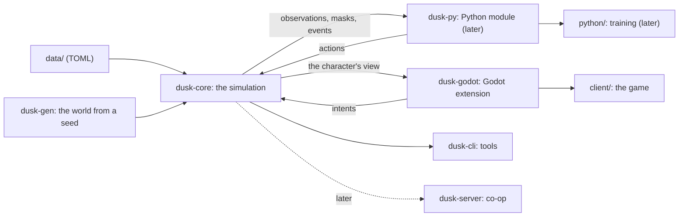

# Duskhold — engine and architecture

*Draft 2, 2026-11-05. `CONCEPT.md` says what the game is; this says how it's built.*

## Decided (2026-11-05)

- **The game comes first.** The bot comes later, to train on the game once there is one, and maybe to drive its NPCs (the user: "the bot is not a primary in this at all. I'm more interested in developing the game"). Four things the bot will need also help the game, so they stay:
  - a deterministic core: any bug or death can be replayed;
  - one rule for timed actions;
  - the game knowing what's possible: the player's greyed-out buttons;
  - the character perceiving only what it should.
- **The stack:** a Rust core and a Godot 4 client, with Python for the bot later.
- **The look:** 3D models under an orthographic camera.
- **The grain:** 10 ticks a second, chunks of 32 × 32 tiles.
- **The setup:** the Rust toolchain and maturin. Where that stands is under "Setup on this PC".

**Default** marks Claude's choices, open to change. **Open** marks questions for the user, listed at the end.

## In one screen

| | Choice |
|---|---|
| Engine | Our own simulation core, `dusk-core`, in **Rust**: all of the game's rules, with no graphics and no I/O |
| The game | A **Godot 4** client that runs the core in-process (a GDExtension, through gdext), draws what the character perceives and sends what the player wants as intents |
| The bot (later) | A **Python** module, `duskhold` (PyO3, built with maturin), that steps many worlds at once on Rust threads into NumPy arrays for training, with `ppo.py` from `11_PPO-Zombie`. Trained policies can then drive NPCs inside the core, with no Python in the game |
| World | Tiles with walls on their edges (Zomboid's way), floors from cellars to attics, chunks of 32 × 32 tiles; full detail near the character, a population layer everywhere else |
| Time | A fixed tick, 10 a second of action time at 1×; a world clock 24× faster (a day is an hour at 1×, Zomboid's default) |
| Determinism | The same build, seed and intents give the same game, tick for tick; a replay is a seed and the intents |
| Content | TOML data files; buildings as text grids; the world generated from a seed out of hand-made pieces |
| Saves | The seed, plus only what changed |
| Look | 3D low-poly models under a fixed orthographic camera at Zomboid's angle |
| Later | Lua (`mlua`) for quests, events and mods; a headless server for co-op |



## Why our own core

The concept asks for things a game engine's simulation layer doesn't give:

- an open world in chunks, with a population layer for what's off-screen, and hundreds of creatures sensing and moving at once;
- time skips: sleeping through a night or waiting out the rain runs the world at hundreds of times real speed (Zomboid fast-forwards a sleep the same way);
- deterministic replays: any bug or death can be played back exactly;
- later, the same rules called from Python for the bot, at 1,000× real time or more per core.

So the core is a library with no graphics, and everything else (the game, the tools, the tests, later the bot) calls it. The cost is writing our own world, systems and tools; Godot is only the client.

## Why Rust

Measured on this PC (2026-11-05, Python 3.14.2, 24 logical CPUs; `research/python_tick_bench.py` and `research/python_hotspots_bench.py`):

| Pure Python | Speed |
|---|---|
| A stripped-down tick: 100 dead hear and see the player and step toward it | 18,900 ticks/s (1,890× real time) |
| The same with 500 dead | 4,900 ticks/s (490×) |
| The character's field of view, radius 20 (recursive shadowcasting) | 0.68 ms each |
| A*, 30–50 tiles | 1.57 ms each |

- **The stripped tick leaves out most of the work:** fields (light, scent, heat), bodies and needs, items, AI states, pathfinding, the bot's field of view at each decision. Ten goblins re-planning once a second is one A* per tick: 1.6 ms, which alone caps Python at about 600 ticks/s. A full tick in Python would land around 400–1,700 ticks/s, 40–170× real time per core (estimate). The game at 1× needs only 10 ticks a second. But a night's sleep fast-forwards eight game hours, 12,000 ticks across the whole active area, and Zomboid does that in a few seconds; the bot later wants 1,000× or more.
- **Rust, measured on identical work (2026-11-06):** `crates/dusk-cli/examples/python_twin.rs` ports the Python script line for line. It ran at 3,600,000 ticks/s with 100 dead (195× the Python script's 18,466 that day) and 700,000 with 500 (151× its 4,651). The real core's numbers are under the performance budget below.
- **PyO3 and maturin** make the core an ordinary Python module. NumPy arrays are filled in place (no copies), and the GIL is released while 16–24 worlds step on Rust threads.
- **gdext** puts the same core inside the Godot game, in-process.
- **WebAssembly** puts it in a browser: replays in the dashboard, maybe a browser build one day.
- **Determinism** comes easily: no garbage collector, integer tiles, and full control of iteration order and randomness.

Considered:

| Option | Why not, at least for the core |
|---|---|
| Python | The quickest to change, and the RL stack's own language. But the numbers above put it at 40–170× real time per core, and every region adds work. It stays for everything around the core |
| C# (Godot's own language) | First-class in Godot, but the Python bridge is clumsy (pythonnet, or a C ABI through NativeAOT) |
| C++ | As fast, but less safe, and its Python and Godot bindings are no better |
| Python + Numba | One language, but entities, inventories and AI fit Numba badly, and Numba trails each Python release by months |
| TypeScript (MeowMix's stack) | Runs natively in a browser, but the bot would have to talk to it over a socket |

The costs of Rust:

- Claude writes it; the user mostly judges behaviour (the dashboard, replays) rather than reading code.
- A toolchain to install.
- Compile times (seconds, incremental).
- The borrow checker pushes the design toward ids and arenas, which suits a simulation anyway.

## Why Godot for the game

- **Practical:** free (MIT) and light, with a real UI system for Zomboid's windows (inventory lists, the health panel, right-click menus), an editor, and exports to Windows, Linux and macOS.
- **In-process:** the core runs inside the game's process through gdext.
- **3D under an orthographic camera** (Default). Zomboid itself draws 3D characters over 2D tiles.
  - Characters are rigged low-poly models: gear shows on the body, they can face any way, and animations are shared across models.
  - Torchlight and day and night are real lighting.
  - Walls are cut away in a shader.
  - Free CC0 kits (Kenney, KayKit, Quaternius) cover the first playable.
  - The alternative, 2D sprites, multiplies the art: 8 directions × every animation × every piece of gear.
- **The client never decides anything.** It draws the view the core gives it and turns input into intents. What's visible is always the core's answer, even where the rendered lighting looks a little different from the gameplay light.

Considered: Bevy (Rust throughout, but pre-1.0 churn and a thin UI and editor), a browser client (PixiJS and the core in WebAssembly: playable on a phone, but the UI and lighting built by hand), and Unity (heavier, with licensing).

## The core: `dusk-core`

### The API, in short

```rust
impl World {
    pub fn new(defs: Arc<Defs>, settings: &Sandbox, seed: u64) -> World;           // a new realm
    pub fn from_scenario(defs: Arc<Defs>, scenario: &Scenario, seed: u64) -> World; // a slice for the bot
    pub fn intent(&mut self, actor: ActorId, intent: Intent); // the player, a bot, an NPC: the same call
    pub fn step(&mut self, ticks: u32);
    pub fn view(&self, actor: ActorId, out: &mut View);       // what this actor perceives (the client)
    pub fn observe(&self, actor: ActorId, out: &mut [f32]);   // the same, as named numbers (the bot)
    pub fn mask(&self, actor: ActorId, out: &mut [bool]);     // what it can do right now
    pub fn events(&mut self) -> Drain<'_, Event>;             // hits, XP, deaths, sounds, messages
    pub fn state_hash(&self) -> u64;
    pub fn save(&self, dir: &Path) -> io::Result<()>;
}
```

An `Intent` is anything a controller can ask for:

- idle;
- move (a heading, walking or running), or walk to a tile (pathfinding);
- attack, shove;
- interact (a door, a container, a window);
- use an item (eat, drink, equip, drop, bandage, ...);
- cast, build;
- toggle sneak, run or light;
- cancel.

A player's click names exactly which item; a bot's "pick up food" names the nearest food worth taking, as in ZomboidRL. Both become the same actions.

### World model

- **Tiles:** each tile (x, y, z) has terrain (grass, mud, road, water, ...), a floor, a roof (so sunlight and rain know what's indoors), a light level and a few flags.
- **Edges** (Zomboid's walls): each tile owns its north and west edge. An edge holds nothing, a wall, a door, a window or a fence, with a material and a state (open, locked, barricade level, health). Whether you can step from one tile to the next depends on the edge between them, and a diagonal step needs both of its sides open: no corner cutting, the lesson of ZomboidRL's `paths`.
- **Fixtures** sit on tiles: furniture, containers, fires, wards, traps, webs.
- **Floors:** z runs from −2 (cellars) to +3 (attics), linked by stairs and ladders. Dungeons, later, are separate maps entered through an entrance.
- **Chunks** are 32 × 32 tiles on every floor. A chunk holds its tiles, edges, fixtures and ground items, plus a flag for whether anything changed.
- **Actors** (the character, NPCs, creatures) are plain structs in a generational arena (`slotmap`), not a general ECS (Default). There are few kinds of entity and we know them all, and plain structs are easier to read, save and keep deterministic.
- **Items are values** (definition, quality, condition, affixes, identified or not, contents) inside an inventory, a container or a tile's ground list. A town holds thousands of them, so they're kept cheap. Only the few that need it carry an id: uniques, attuned items, a revenant's gear.
- **Containers fill from the seed.** What's in a cupboard is a function of the seed and the cupboard's position, so an unopened container stores nothing. It's filled the first time someone looks, and saved from then on.
- **Definitions** (creatures, items, spells, rooms: everything from the data files) are loaded once, read-only, and shared by every world on every thread.

### Time

- **Action time:** a tick is 0.1 s at 1×. Movement, swings and timed actions count ticks.
- **The world clock** runs 24× faster by default: a game day is an hour at 1×, Zomboid's default day length and a sandbox setting. So a tick is 2.4 s of clock time. Day and night, needs, healing, crops, weather and the Long Dusk run on the clock, while a swing still takes a real second. Zomboid works the same way.
- **Speeds:** pause, 1×, 2×, 5× and "faster while safe" for players; uncapped for bots.
- **Not every system runs every tick:**

  | Every | Runs |
  |---|---|
  | tick | actions, movement, combat |
  | 5 ticks | perception and AI for most creatures, the sound and scent fields, the bot's decision (Default) |
  | 10 ticks | bodies, needs, moodles |
  | 100 ticks | fire, weather, the population layer |
  | clock hour or day | holdout stores, loot respawn, the Long Dusk |

  Each system's turn is staggered by actor id, so a hundred creatures don't all think on the same tick.

### The tick, in a fixed order

1. **Intents** from controllers (the player's input, bots, NPC and creature AI) start, continue or replace actions.
2. **Actions** progress, pay out, finish or get interrupted (see below).
3. **Movement:** tile-to-tile steps with progress, drawn smoothly. The tile ahead is reserved, so two actors never share a tile, and doorways are real chokepoints.
4. **Combat:** strikes land on their strike tick. Reach, facing, the body part hit, armour, wounds, knockback, grabs and being dragged down all resolve here.
5. **Emissions:** each actor and fixture gives off noise, light, movement, scent, heat and dread for this tick.
6. **Fields** update on their schedules: light, sounds, scent, heat, web vibrations.
7. **Perception:** each creature senses with its family's senses and updates what it remembers.
8. **AI:** creatures decide; their intents take effect next tick.
9. **Bodies and needs:** bleeding, hunger, thirst, fatigue, temperature, afflictions, moodles.
10. **The world:** fire spread, weather, the clock, the dead getting up, the population layer.
11. **Events out:** XP, quest progress, telemetry, deaths.

### One rule for every timed action

Every action has:

- a check for whether it can start here and now;
- a duration in ticks, scaled by skill;
- what it does as it goes (drinking pays out as it goes, as in Zomboid);
- what it does when it's done;
- its noise and light;
- what interrupts it: a hit, a threat within reach once its first half-second is up, or the actor choosing something else.

Choosing the same action again carries on with it; choosing another replaces it. Players can queue actions while paused, as in Zomboid. Creatures follow the same rule: a ghoul eating a corpse is an action, and it can be interrupted.

In ZomboidRL this hold, carry-on and interrupt logic grew one action at a time (eat, drink, bandage, pickup, gear). Here it's written once.

### Senses and fields

- **Emissions** per actor:
  - noise, as a radius;
  - light, from what it carries;
  - movement: speed × weight;
  - scent, left on its trail;
  - heat, from its body, clothes and fires;
  - dread, its own.
- **Light:** sky light (time of day, weather, roofs, windows letting it in) is cached per chunk and redone when something changes. Moving lights (torches, fires, spells) use shadowcasting within their radius. The result is one number per tile.
- **Sight:** the character's field of view uses symmetric shadowcasting, adapted to walls on edges, then cut to its vision cone, to lit tiles and to darkvision. A creature checks a line of sight only to a target it could see: in range, and lit or within its darkvision.
- **Sounds** are events (where, how loud, what kind). Creatures in range hear them, and every wall on the way costs loudness.
- **Scent** is a coarse grid, one cell per 2 × 2 tiles, with deposits, decay, wind and rain.
- **Heat** comes from emitters plus the ambient temperature, and needs a line of sight to sense.
- **Vibration:** footsteps carry within a radius; webs form a graph that carries every touch.
- **Dread** is each actor's own number. Ghosts sense it within range, through walls.
- **A region is mostly data.** A family's data says which senses it uses, at what ranges and thresholds, and how it moves (walks, climbs webs, passes through walls). A new region adds data and an AI module, not engine changes.

### Creature AI

- **Per family:** a state machine with utility scores (idle, wander, investigate, chase, attack, flee, feed, sleep, go home), configured in data.
- **Intelligence is a budget:**
  - the dead steer straight at what they sense and share flow fields, so the Tolling moves hundreds of them for the cost of one field;
  - goblins plan with A*: loot, steal, ambush, call for help;
  - wolves steer as a pack: circle, flank, rush.
- **Thinking is staggered:** the dead every 5 ticks, goblins every 2, a boss every tick.

### Pathfinding

A* runs over tiles and edges: doors cost time, and closed doors are passable only for those that can open them. Long trips use hierarchical paths across chunks (portals between chunks), crowds share flow fields, and each chunk's change counter invalidates cached paths through it.

### Bodies, items and combat

All the numbers come from the data files. A body has parts with wounds (type, severity, bleeding, bandaged, infected), pain and armour per part; moodles are worked out from these every 10 ticks. An attack is an action: a wind-up, a strike tick and a recovery.

### The open world: chunks and the population layer

- **The active area:** chunks within 3 chunks (96 tiles, Default) of an anchor run in full. Anchors are the character, any bot, and important NPCs.
- **Everywhere else, a population layer** is updated every clock hour. Per chunk it keeps how many of each family there are and which way they're drifting, plus each holdout's stores, defenders and morale. Raids and migrations move these counts between chunks.
- **Waking a chunk** turns its counts into creatures, placed by family rules: the dead in houses and streets, spiders on webs.
- **Putting a chunk to sleep** folds its creatures back into counts. Named ones (rares, revenants, NPCs) stay real.
- **Zomboid works this way** (its "virtual zombies"), which is how its towns stay full without simulating every zombie.

### Determinism and randomness

- **One thread per world.** Its systems run in a fixed order and its actors in id order. Many worlds run in parallel, one per thread.
- **No hash-map iteration in game logic.** B-tree maps, `IndexMap` or sorted vectors instead, and hashing with fixed seeds.
- **Randomness:** world generation draws from ChaCha streams keyed by (seed, layer, chunk). Gameplay rolls are hashed from (seed, tick, actor, purpose), so a new roll in one system doesn't shift the rolls of every other.
- **Numbers:** tiles are integers. Floats (health, needs) only appear where matching on the same build and machine is enough.
- **Checks and replays:** tests call `state_hash()` every tick. A replay is the seed, the scenario and the external intents, since everything else follows from them.

### Saves

- **What's saved:**
  - the seed, the data version and the realm's large-scale layout;
  - only the chunks that changed (like Zomboid's `map_X_Y` files);
  - the actors and the clock.
- **Format:** `serde` with `postcard`, a version header and explicit migrations.
- **Everything else comes back from the seed:** unchanged chunks and unopened containers.
- **Autosave** every clock hour.

## World generation: `dusk-gen`

- **The large-scale layout comes first,** once per realm, in seconds:
  - the realm: the six regions around the heartland, and their borders;
  - terrain: height and moisture, which give each region its biomes;
  - rivers down the height map;
  - roads between settlements;
  - sites: towns, holdouts, farms, camps, and later dungeon entrances.
- **Chunks are made on demand,** each from its seed, its position and the large-scale layout, so a chunk comes out the same whatever order chunks are made in:
  - town streets and lots;
  - buildings from prefabs, rotated and mirrored to fit;
  - furniture and containers by room;
  - loot by room, region and depth;
  - creature counts by family and density.
- **Prefabs are text** (Default), so Claude can write dozens of houses and a diff shows what changed:
  - edge rows (even rows) alternate `+` corners with horizontal edges;
  - cell rows (odd rows) alternate vertical edges with cells, so cells sit in the odd columns;
  - on an edge, `|` or `-` is a wall, `D` a door, `W` a window and a space is open;
  - the legend maps each cell's letter to a floor, furniture, a container and loot.

```toml
[[prefab]]
id = "hush_cottage"
tags = ["house", "rural", "hushlands"]
grid = """
+-+-+-+-+
|b .|k .|
+ + +D+-+
|. . . .D
+-+W+-+-+
"""
[prefab.legend]
"." = { floor = "planks" }
"b" = { floor = "planks", furniture = "bed", loot = "bedroom" }
"k" = { floor = "planks", furniture = "cupboard", loot = "kitchen" }
```

Other floors are more grids (`grid_up`, `grid_cellar`), and stairs are a legend entry. Tools:

- `dusk-cli gen --seed 42 --png` draws a realm's map;
- `dusk-cli prefab show hush_cottage` draws a prefab;
- `dusk-cli check` validates all the data.

## Data files

```
data/
  creatures/   hushlands.toml  warren_hills.toml  ...
  items/       weapons.toml  armour.toml  food.toml  tools.toml  ...
  affixes.toml  traits.toml  ancestries.toml
  spells/  classes/  regions/  prefabs/  loot/  recipes/  blueprints/
  presets/     sandbox/  training/
```

```toml
[[creature]]
id = "shambler"
family = "dead"
senses = { hearing = 14, sight = 6, darkvision = 0 }   # tiles
speed = { walk = 0.6, chase = 0.9 }                     # tiles a second
health = 30
attacks = [{ kind = "bite", reach = 1.0, windup = 6, damage = 6, grabs = true }]
think_every = 5                                          # ticks
weak_to = ["fire", "blessed"]
```

- **Loading:** the data is loaded and checked once: types through `serde`, then cross-references (every loot table, item and spell a file names must exist).
- **Reloading:** changed data reloads in dev builds without a restart.
- **Mods:** a mod is a folder of the same files, loaded after the base game's.

## Later: the bot (training, then NPC AI)

Not before the game is playable (build step 7). The core is shaped for it from the start, so adding it later is a binding, not a rewrite.

```python
import duskhold as dh

sim = dh.VecSim(n=16, data="data", scenario="training/hush_street", seed=1)
obs = sim.reset()                       # (16, n_inputs) float32, filled in place
names = sim.obs_names()                 # stable names by group, read by PPO.from_checkpoint
amask, kmask = sim.masks()              # what each world's character can do now
obs, rew, term, trunc, info = sim.step(actions)   # 5 ticks a step, 16 worlds on 16 threads
```

- **Wrappers:** `gymnasium.Env` and `VectorEnv` around it. `ppo.py` is copied from `11_PPO-Zombie` and taught to roll out many worlds at once. The telemetry and the dashboard come along, with a debug map drawn from the core's view.
- **Scenarios are data:** a region, a place (a farmhouse, a town street, a forest camp), the time, the season, a kit, a creature density and a step limit. A sampler mixes them into a curriculum.
- **Observation:** named inputs in groups, built in Rust straight into the shared array, with every sense present from the start:
  - vitals, body, moodles;
  - the signature: how loud, bright, fast, scented, warm and frightened the character is;
  - what it sees: sectors, and the nearest few creatures;
  - what it hears: loudness per sector;
  - the 9 × 9 tiles around it: walls, doors, light, walking distance;
  - the nearest item worth taking of each kind, gear, what's carried;
  - the base: where it is, and whether you're in it;
  - the time, the weather, the region.
- **Actions:** a verb plus a kind, as in ZomboidRL, with masks from the core.
- **Reward:** the game's own events, weighted by a table in the scenario: XP for what's brought home, the alive bonus, wounds, death.
- **Replays:** a seed and the intents, so the dashboard can play any episode back exactly.
- **Throughput target:** 1,000× real time or more per core. ZomboidRL makes 3–6 decisions a second; 16 worlds here would make 30,000 or more. At that point the trainer, on the RTX 3080 Ti, is the bottleneck, which is where we want it.
- **NPC AI from a trained policy:** a policy is a small network (ZomboidRL's has 256 units a layer). Its weights are exported from `ppo.py` to a file the core reads, and the core runs it as one more kind of controller for an NPC or a creature. It uses the same observation builder and masks the bot trained on, and a decision costs tens of microseconds in plain Rust, with no Python and no ML library in the game. Hand-written AI stays the default; a policy takes over a role where it plays better (a rival survivor, a holdout's scavenger).

## The game: `client/` (Godot)

- **The core runs on its own thread inside the game** (through `dusk-godot`), ticking at the chosen speed. After each tick it publishes a view, and the renderer draws smoothly between the last two.
- **The view is what the character perceives:** visible and remembered tiles, light, the creatures it can see, items, effects and sounds. The client can't show what the character doesn't know, the same rule as the bot's.
- **The view also carries what the readability pillar draws** (`CONCEPT.md`, "What hunts you, you can see"):
  - the noise rings made this tick, with their reach;
  - each visible creature's sight cone and alert state;
  - your scent trail, heat and tremors;
  - the lines from adjacent enemies (engagement);
  - each attack's tell while it winds up.

  The core computes these anyway, so drawing them costs the client nothing more than a decal.
- **Rendering** (Default: 3D, orthographic, at Zomboid's angle):
  - chunks as instanced meshes, and walls as thin meshes on tile edges;
  - a cut-away shader for walls between the camera and the character, and the floors above hidden when indoors;
  - the core's light and visibility as textures (one texel per tile, sampled smoothly), plus real shadows from the light the character carries;
  - weather particles.
- **UI** (Godot controls): the moodle column, the health panel, inventory windows with weight bars, Zomboid-style right-click menus, progress bars, the map, the speed dial, build mode.
- **Input becomes intents:** click to walk (pathfinding), WASD to steer, hotkeys, context actions, and a queue while paused.
- **Sound** is positional, played from the core's sound events.

## Later: scripting, mods, co-op

- **Lua** (`mlua`; the user knows Lua from ZomboidRL's mod) for quests, events and mods, kept out of the hot path.
- **Co-op:** `dusk-server` runs the core headless. Clients send intents and receive their character's view as deltas. The server decides everything, so a client can only ever show what its character could see anyway.

## Repository layout

```
12_Duskhold/
  CONCEPT.md  ARCHITECTURE.md  CLAUDE.md
  Cargo.toml                 Rust workspace
  crates/
    dusk-core/               the simulation: world, rules, systems (no graphics, no files, no threads)
    dusk-data/               data file types, loading, checks
    dusk-gen/                world generation from a seed
    dusk-godot/              the Godot extension (gdext), step 3
    dusk-cli/                tools: demo, bench; later check, gen, prefab show, replay
    dusk-py/                 the Python module `duskhold` (PyO3, maturin), later
  data/                      the game's content (TOML)
  client/                    the Godot project
  python/                    training, telemetry, the dashboard (from 11_PPO-Zombie), later
  research/                  measurements behind decisions (the Python benchmarks)
  tests/                     golden replays, Python API checks
```

## Tests and tools

- **Rust:** unit tests per system, and property tests for invariants (no actor inside a wall, weights add up, no item in two places).
- **Golden replays:** a scenario, a seed and its intents give a fixed state hash. A change in behaviour changes the hash; an intended change updates it.
- **Determinism:** the same run twice, and on 1 thread vs 16, gives the same hashes.
- **Benchmarks** (`criterion`): ticks a second for fixed scenarios (a quiet farmhouse, a street with 100 dead, the Tolling with 500).
- **Python:** Gymnasium's environment checker, stable input names, masks that agree with what the actions do, and a toy training run.
- **No fake game needed:** ZomboidRL's `lua_harness.py` had to fake the game; here the core is the game.

## Setup on this PC

State on 2026-11-05:

- **Rust 1.99.1** (rustup, stable, MSVC host) in `%USERPROFILE%\.cargo` and `.rustup`, outside OneDrive. New terminals find `cargo` on the PATH.
- **maturin 1.16.0** in the project's own `.venv` (Python 3.14.2), ready for the bot later.
- **Build output** goes to `%LOCALAPPDATA%\cargo-target` (`CARGO_TARGET_DIR`, set for the user with `setx`).
  - Rust's `target/` folder grows to gigabytes of small files, and OneDrive would sync every one of them.
  - It also keeps paths under Windows' 260-character limit (the root CLAUDE.md's warning).
  - `target/`, `.venv/` and Godot's `.godot/` cache are gitignored.
- **Visual Studio 2022 C++ Build Tools** (MSVC 14.44.35207), the linker the MSVC toolchain needs. They were installed by 2026-11-06, after the first try (winget, 2026-11-05) ended with exit code 1602, the admin prompt cancelled. If they're ever missing, `cargo check`, `clippy` and `fmt` still work, but nothing links. The install command, run in PowerShell with the admin prompt approved (about 5 GB):

  ```powershell
  winget install --id Microsoft.VisualStudio.2022.BuildTools -e --override "--passive --wait --norestart --add Microsoft.VisualStudio.Workload.VCTools --includeRecommended"
  ```
- **Godot 4.7.2** (standard build), installed 2026-11-06 in `%LOCALAPPDATA%\Programs\Godot`, outside OneDrive. It came from the official GitHub release, checked against its SHA-512 sum. `Godot_v4.7.2-stable_win64.exe` is the editor; `Godot_v4.7.2-stable_win64_console.exe` is the same program printing to the terminal (for scripts and `--version`).

## Performance budget (per world, one thread)

| Part | Budget per tick (average) |
|---|---|
| actions, movement, combat | 10 µs |
| perception and AI for 100 creatures, staggered | 20 µs |
| fields: light, sound, scent | 10 µs |
| the bot's field of view and observation, every 5 ticks | 5 µs |
| bodies, needs, the world | 5 µs |
| **total** | **about 50 µs: 20,000 ticks/s, 2,000× real time** |

The benchmarks check this from the first week. A part over budget gets profiled before it gets more features.

Measured on 2026-11-06 (`dusk-cli bench`, release build). The map is 96 × 96 with 12% rock, you wander about, and a noise every second carries 20 tiles:

| Dead | Thinking every 5 ticks (the game) | Thinking every tick |
|---|---|---|
| 100 | 157,000 ticks/s (15,700×) | 69,000 ticks/s |
| 500 | 16,500 ticks/s (1,650×) | 6,500 ticks/s |

- **100 creatures** run at 8× the budget.
- **500**, a horde the size of the Tolling's, falls short of it. Each shambler that can't walk straight at you plans its own A* path, and every node of a search checks its 8 steps tile by tile across chunk lookups.
- **The planned fixes:**
  - flow fields, so a crowd heading for one place shares a single field;
  - a per-chunk cache of which steps are open, rebuilt when a chunk changes.
- **For gameplay,** 16,500 ticks/s still fast-forwards a night's sleep (12,000 ticks) in under a second.

## Risks

- **Rust's learning curve** falls on Claude; the user judges behaviour (the dashboard, replays) more than code. Mitigation: small crates, plain structs, and a comment wherever a rule lives.
- **gdext** is community-maintained. Fallback: the core as a separate process talking over shared memory, or through a C ABI.
- **Art:** 3D needs models and animations. CC0 kits first, our own art later.
- **Scope:** the first playable is one small region; everything else is a layer on a working core.
- **Determinism bugs** (iteration order, floats) are caught by the hash tests from the first week.

## Build order

Game first: every step ends with something to look at or play.

1. **Toolchain and workspace.** Done (2026-11-05, Build Tools by 2026-11-06). The workspace has `dusk-core` and `dusk-cli`, with no dependencies yet.
2. **A core that walks.** Done 2026-11-06: 19 tests pass, clippy is clean, and the demo and the benchmarks run. What it has:
   - tiles, walls on edges, chunks and floors;
   - the text grid (the same format for prefabs, test maps and the debug view);
   - the tick;
   - walking and running, tile to tile, with no corner cutting and no two actors on a tile;
   - `WalkTo` with A*;
   - footsteps that walls, shut doors and windows muffle;
   - sight lines that walls and shut doors block and glass doesn't;
   - a shambler that hears and sees, goes after what it noticed, gives up after 30 s and shuffles about meanwhile;
   - how it gets there:
     - straight at it while it's in sight and that step is open;
     - otherwise along a path through doors and round walls, with a small search budget (the dead aren't clever);
     - where there's no way, pressing against the wall;
     - it has only reached you when it could step onto your tile, never diagonally across a door frame;
   - the first demo run found the greedy-only chase (a shambler walking away from its door), and the fix came with 3 tests;
   - a state hash with a determinism test, and tests for each of the above;
   - `dusk-cli demo` (the scene, printed once a second), `dusk-cli bench` (the performance table), and the `python_twin` example (the language comparison).
3. **On screen: the Godot client's skeleton.** Godot 4 and `dusk-godot` (gdext), with the core on its own thread.
   - The 3D orthographic view of a few chunks: floors and walls on edges.
   - The character and shamblers moving smoothly between ticks.
   - Click to walk and WASD as intents.
   - Cut-away walls.
   - Noise rings and sight cones from the core's view: the readability pillar from the first frame.
   - The first thing you can play with.
4. **A seeded Hushlands patch** (`dusk-gen`, `dusk-data`): terrain, a road, a hamlet of prefab houses with containers and loot, and chunks waking and sleeping around the character. The rules move into the data files.
5. **Survival rules:**
   - bodies and wounds, moodles, needs;
   - items and the inventory window;
   - the one rule for timed actions;
   - combat as an economy (`CONCEPT.md`): endurance shared with running and exhaustion; the verbs, each with a wind-up, a strike tick and a recovery; tells per family; engagement; grabs with a way out;
   - skill XP gated by risk, with repeats paying less;
   - doors to open and barricade;
   - day and night, light and the field of view.
6. **The first playable:** base-building basics, the abbey holdout, death and revenants, ghoul fever, the Tolling.
7. **Later, the bot:** `dusk-py` and training with `ppo.py`, then trained policies as NPC controllers.

## Open questions

None right now (2026-11-06). New ones get listed here.
